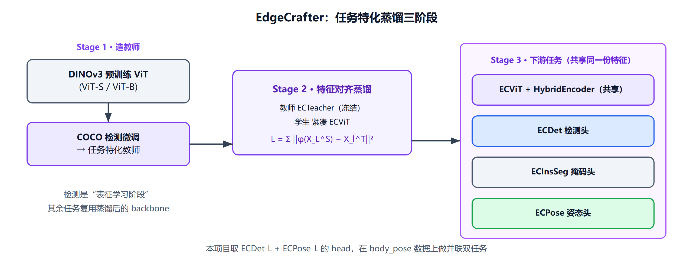
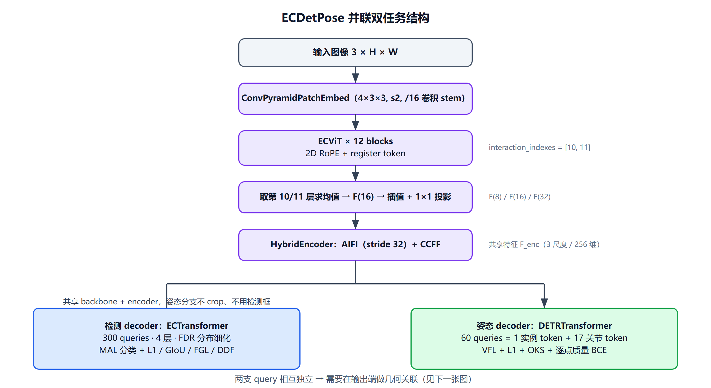
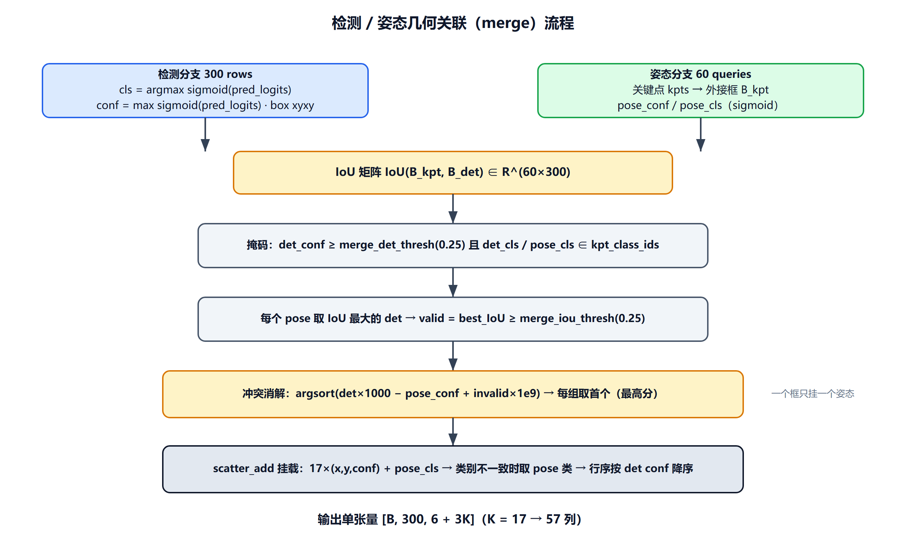
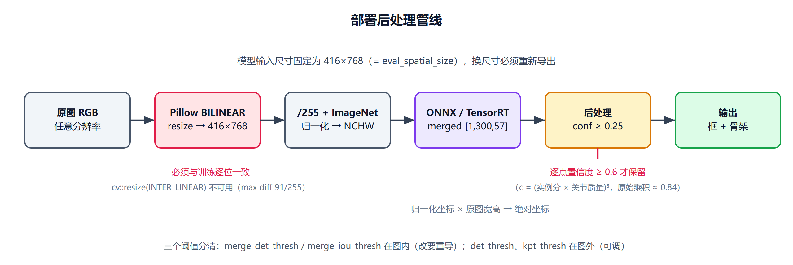

> 本文记录一次把 EdgeCrafter 从「单任务检测 / 单任务姿态」改造成「共享 Backbone 的并联双任务」，并最终压成单个 ONNX/TensorRT 模型上线的完整过程。
> 内容分三块：模型原理与结构、多任务合并逻辑分析（双任务合并、关键点置信度、det/pose 关联）、部署阶段的后处理策略，最后附一段踩坑试验记录。

---

## 一、EdgeCrafter 是什么

### 1.1 它要解决的问题

边缘设备上做稠密预测（检测 / 分割 / 姿态）长期是 CNN 的天下。原因不复杂：小模型 + 大 stride 的 patch embedding 在定位任务上信息损失太大，而把 ViT 缩到 10M 参数级别后，即便挂上 ImageNet-21K 监督预训练，下游检测精度也常常不升反降。

EdgeCrafter 的判断是：**瓶颈不在 ViT 这个结构，而在于小 ViT 没有学到任务特化的表征**。于是它把「表征学习」和「任务学习」拆成两个阶段：先用一个大模型当老师，教小模型学出「对稠密预测有用」的特征；再把这个特征拿去做检测、分割、姿态。

### 1.2 三阶段流水线



*图 1：EdgeCrafter 的任务特化蒸馏三阶段。检测是"表征学习阶段"，蒸馏出的 backbone 再被分割、姿态任务复用。*

关键点在于 **Stage 3 的三条分支共享同一套 backbone + encoder**，任务差异只体现在轻量预测头上。这也正是本项目做双任务的合法性来源：检测和姿态本来就应该吃同一份特征。

蒸馏损失非常克制，只用学生最后一层的特征去对齐老师最后两层：

```text
L_distill = Σ_{l ∈ {L−1, L}}  ‖ φ(X_L^S) − X_l^T ‖²₂
```

其中 `φ(·)` 是逐 token 的单层线性适配器。作者刻意不做重投影头——否则容量会被投影头吃掉，学生本体学不到东西。

### 1.3 结构细节（对应 `ecdetseg/engine/edgecrafter`）

**Backbone：ECViT**

- **卷积 stem 代替 patch embedding**：`ConvPyramidPatchEmbed` 用 4 个 `3×3 / stride=2` 卷积把 640×640 压到 40×40，总 stride 仍是 16，但局部信息是逐级聚合的，而不是一步大 stride 投影丢掉。这对定位任务很关键。
- **2D RoPE + register token**：`RopePositionEmbedding` 按 head_dim 生成 sin/cos，只作用于 patch token，cls/register token 不旋转；前面额外拼一个可学习的 `register_token` 用来吸收全局冗余。
- **只取最后两层**：`interaction_indexes=[10, 11]`，第 10、11 层（共 12 层，即最后两层）的输出被收集。

**多尺度特征构造（`ViTAdapter.forward`）**

```text
F(16) = ½ · (X_{L−1} + X_L)
F(s)  = Θ_s( B_s( F(16) ) ),      s ∈ {8, 16, 32}
```

即：最后两层取平均 → reshape 成 stride 16 的特征图 → 双线性插值到 stride 8/16/32 → 各自一个 1×1 卷积投影到 256 维。没有 FPN，没有额外金字塔模块，参数开销几乎为零。

**Encoder：HybridEncoder（RT-DETR 风格）**

- AIFI：只在 stride 32 的最粗层做一次 self-attention（`use_encoder_idx=[2]`，1 层，8 head），扩大感受野；
- CCFF：`RepNCSPELAN4` + `SCDown` 做 top-down FPN 和 bottom-up PAN，`fuse_op: sum`（DEIM 的写法，比 concat 省通道）。

**检测头：ECTransformer（D-FINE 系）**

- 300 个 query，4 层 decoder，`eval_idx=-1`；
- 分类用 **MAL**（Matching-aware Loss），回归用 **FDR**（Fine-grained Distribution Refinement）：每个边界预测 `reg_max+1=33` 个 bin 的分布，再用非均匀权重函数 `W(n)` 做积分

```text
d̂ = Σ_{n=0..N} Pr(n) · W(n)
# W(n) 是由 reg_max=32、reg_scale=4 生成的非均匀权重函数
```

- LQE（Location Quality Estimator）用 top-k 分布统计量修正分类分数；
- 训练带 DN（denoising，100 个 query，label noise 0.5，box noise 1.0）。

检测总损失：

```text
L_det = λ_mal·L_mal + 5·L_L1 + 2·L_giou + 0.15·L_fgl + 1.5·L_ddf
```

**姿态头：DETRTransformer（DETRPose 系）**

这是双任务里更"贵"的一支，结构上有三个特点：

1. **结构化 query**：每个实例 query 由 1 个 instance token + `K=17` 个 keypoint token 组成，即 `[B, 60, 1+K, 256]`。关节身份通过 `keypoint_embedding` 注入，所以第 `k` 个 token 天生知道自己是"左肩"还是"右膝"。
2. **三种 attention**（`DeformableTransformerDecoderLayer`）：
   - *within-instance*：同一实例内 1+K 个 token 互看（`flatten(0,1)` → `[B·Q, 1+K, C]`），让 instance token 与各关节联合推理；
   - *across-instance*：把 60 个实例的**同号关节**拉到一起（`transpose(1,2).flatten(0,1)` → `[B·(1+K), Q, C]`），在拥挤场景里抑制重复预测；
   - *deformable cross-attention*：每个关节以自身 reference point 在多尺度特征上采 4 个点。
   三者之后用一个 `Gate` 做可学习加权融合，再进 FFN。
3. **FDR 也用在关键点上**：`pose_embed` 输出 `2*(reg_max+1)` 维分布，`distance2pose` 解码成绝对坐标：

```text
x_k = x_k^ref + d̂_{x,k} / reg_scale
y_k = y_k^ref + d̂_{y,k} / reg_scale
```

   每层迭代时把上一层结果 `.detach()` 作为新的 reference，形成级联细化。

姿态损失（本项目配置）：

```text
L_pose = 2.0·L_vfl + 10.0·L_kpt + 4.0·L_oks + 1.0·L_kpt_score
```

其中 VFL 的目标分数不是 1，而是匹配对的 **OKS**——分类分数天然带姿态质量语义。`L_kpt` 只对可见点算 L1：

```text
L_kpt = (1/N) · Σ_j Σ_k v_{j,k} · ( |x̂_{j,k} − x_{j,k}| + |ŷ_{j,k} − y_{j,k}| )
```

OKS 定义（`σ_k` 是 COCO 每个关节的常数，`k_k = 2σ_k` 是论文里的 per-joint 系数，`A` 是实例框面积）：

```text
OKS = ( 1 / Σ_k v_k ) · Σ_k v_k · exp( − d_k² / (2 · A · k_k²) ),      k_k = 2σ_k
```

> 代码里的写法是 `dist² / (area * (2σ)² * 2)`（`keypoint_loss.py:16`），和 pycocotools 的 `vars=(sigmas*2)**2; e = d²/vars/(area)/2` 完全一致，不要误以为多乘了一个 2。

### 1.4 规模与指标

| 模型 | Backbone | Embed | Heads | Encoder Hidden / FFN | 参数量 | COCO box AP |
|---|---|---|---|---|---|---|
| ECDet-S | ECViT-T  | 192 | 3 | 192 / 512  | ~10M | 51.7 |
| ECDet-M | ECViT-T+ | 256 | 4 | 256 / 512  | ~18M | 54.3 |
| ECDet-L | ECViT-S  | 384 | 6 | 256 / 1024 | ~31M | 57.0 |
| ECDet-X | ECViT-S+ | 384 | 6 | 256 / 2048 | ~49M | 57.9 |

ECPose 对应 68.9 / 72.4 / 73.5 / 74.8 AP。T4 + TensorRT FP16、batch=1 下，ECDet-L 约 10.5ms、ECPose-L 约 11.8ms。本项目双任务用的是 L 规格（ECViT-S，embed 384 / 6 heads / proj 256），实测 39.85M 参数、93.7 GFLOPs（416×768 输入）。

---

## 二、多任务合并逻辑分析

### 2.1 整体形态：并联，不是级联



*图 2：ECDetPose 的网络结构与两支 decoder。共享 backbone + encoder，检测 300 query、姿态 60 query 完全并联。*

`ECDetPose.forward`（`ecdetpose/engine/edgecrafter/detpose.py:240`）非常直白：

```python
feats   = self.forward_features(samples)
det_out = self.det_decoder(feats, targets)
pose_out = self.pose_decoder(feats, pose_targets, samples if self.training else None)
return {"det": det_out, "pose": pose_out}
```

**姿态分支不看检测框、不 crop、不做 RoIAlign**。两支只在 backbone + encoder 处汇合。这个选择的代价是：检测框和关键点之间没有 query 级的一一对应，必须在输出端另做关联（见 2.4）；好处是姿态分支保留了完整的图像上下文——对"攀爬""躺坐"这类强依赖环境的动作反而更友好。

> 顺带一提，仓库里还留着两条实验分支：`detpose_gate`（`PoseGuidedFusionHead`：用检测框做 RoIAlign + 姿态 query 软关联，只对动作类加零初始化残差）和 `detpose_cascade`（用检测 query 初始化和检测框模板初始化姿态 reference）。两者都没合并进 `main`，属于并行探索，主线仍是并联方案。

### 2.2 双任务是怎么"合并"起来的

这里的"合并"其实发生在四个层面，缺一层都跑不通。

#### ① 数据层：`pose_mask` + IoU 对齐

标注是两套：`annotations_detection`（10 类检测框）和 `annotations_keypoint`（17 点姿态）。合并脚本 `dataset/body_pose/tools/build_multitask_coco.py` 按**同一张图 + 框 IoU ≥ 0.95** 把关键点挂到检测框上，并写入 `pose_mask`：

```python
PERSON_ACTION_CATEGORY_IDS = set(range(7))        # 0..6 有姿态标注

annotation["keypoints"]    = [0.0] * 51
annotation["num_keypoints"] = 0
annotation["pose_mask"]    = 0
if det.category_id in PERSON_ACTION_CATEGORY_IDS and available_keypoints:
    if box_iou(det.bbox, kp.bbox) >= 0.95:
        annotation["keypoints"]    = kp["keypoints"]
        annotation["num_keypoints"] = kp["num_keypoints"]
        annotation["pose_mask"]    = int(kp["num_keypoints"] > 0)
```

产出的 10 类里，只有 0–6 是带姿态的人体动作：

| id | 0 | 1 | 2 | 3 | 4 | 5 | 6 | 7 | 8 | 9 |
|---|---|---|---|---|---|---|---|---|---|---|
| 类别 | 人-蹲 | 人-攀爬 | 人-坐 | 人-趴 | 人-躺坐 | 人-躺 | 人-站 | 人-未知 | 狗 | 遛狗牵绳 |
| 关键点 | ✓ | ✓ | ✓ | ✓ | ✓ | ✓ | ✓ | ✗ | ✗ | ✗ |
| 训练框数 | 621 | 1,619 | 5,633 | 1,011 | 286 | 1,602 | 8,693 | 4,674 | 6,475 | 1,347 |

当前联合标注（`annotations_multitask`，2026-08-12 重新生成）：

| split | 图片 | 检测框 | `pose_mask=1` 实例 |
|---|---|---|---|
| train | 12,346 | 31,961 | 19,213 |
| val | 2,892 | 6,655 | 3,964 |

> `TRAIN.md` 和 `readme.txt` 里写的 6,404 图 / 16,027 框 / 11,960 实例是更早一版联合标注的统计；后来并入 cluster0002、panpa、sleep 之后规模明显变大，脚本里的数字没同步更新。以 json 实际内容为准。
>
> 类别分布极度不均衡：`人-站` 8,693 vs `人-躺坐` 286，差 30 倍。这是后面动作分类需要 class-balanced 权重、以及评测必须看 per-class AP 而不是只看 mAP 的根本原因。

`CocoDetection` 里 `pose_mask` 会跟随框的合法性一起过滤（`coco_dataset.py:194`），并在 `_pose_targets` 中被用来**只把有姿态监督的实例喂给姿态 decoder**：

```python
mask = target[pose_mask_key].bool()
pose_target[key] = value[mask] if key in instance_fields else value
```

所以一个 batch 里可以同时有狗、牵绳（只走检测损失）和人体（走两路损失）。这也带来一个 DDP 副作用：某个 rank 的 batch 可能一个姿态实例都没有，pose denoising 分支不参与前向 → 必须开 `find_unused_parameters: True`。

#### ② 损失层：`MultiTaskCriterion`

```python
det_losses  = self.det_criterion(outputs["det"], targets, **kwargs)
pose_losses = self.pose_criterion(outputs["pose"], _clone_targets_for_pose(targets, pose_mask_key))
losses[f"det_{k}"]  = v * det_weight
losses[f"pose_{k}"] = v * pose_weight
```

两支损失独立计算、独立匹配（检测用 `HungarianMatcher`，姿态用 `DETRPoseHungarianMatcher`，后者代价里含 OKS 项），只靠前缀区分日志，权重默认 1:1。

`best.pth` 的选择也不是看单任务，而是联合分数（`detpose_solver.py:599`）：

```text
S = ( w_bbox · AP_bbox + w_kpt · AP_kpt ) / ( w_bbox + w_kpt ),      w = (0.6, 0.4)
```

配置在 `ecdetpose.yml:12`，缺失的指标会自动从归一化分母里剔除（单任务时退化为该任务 AP）。

#### ③ 参数层：`shared_init` + 分支映射

两个单任务 checkpoint 的 key 前缀都是 `backbone. / encoder. / decoder.`，合并时必须拆开：

```python
def _mapped_branch_state(state, branch, load_shared=False):
    if load_shared and key.startswith(("backbone.", "encoder.")):
        mapped[key] = value
    if key.startswith("decoder."):
        mapped[f"{branch}_decoder.{key[len('decoder.'):]}"] = value
```

于是：

- `shared_init: pose` → 共享部分取 ECPose-L 的 backbone/encoder，`det_decoder` 取 ECDet-L，`pose_decoder` 取 ECPose-L；
- `shared_init: det` → 共享部分取 ECDet-L。

这两种初始化都只是"起点"，联合训练会把共享特征拉向一个折中点。项目里两种都跑过，最终主线配置用 `pose`（`ecdetpose_l_body_pose_multitask.yml:11`），`_ecdet_matched` 变体用 `det`。

#### ④ 输出层：`merged_output` 单张量（部署专用）

训练/评估时输出是 `{"det": ..., "pose": ...}` 两个 dict，走两个 postprocessor；部署时把 `merged_output=True`，`_merge_outputs` 在**图内**完成几何关联，直接吐一个 `[B, N, 6+3K]`。详见 2.4 与第三节。

### 2.3 关键点置信度：从"没有"到"逐点可判"

**问题**：`DETRPosePostProcessor` 里每个关键点的 vis 是硬编码的 1：

```python
keypoints_res = torch.cat([keypoints_res, torch.ones_like(keypoints_res[..., 0:1])], dim=-1)
```

也就是说，模型只告诉你"这个实例有多少分"，不告诉你"第 7 个点是左脚踝、它到底可不可信"。下游想把烂点过滤掉，只能自己拍阈值——而 vis 恒为 1 时阈值根本没有意义。

**做法**：在姿态 decoder 每一层加一个 per-keypoint 质量分支（`detrpose_transformer.py:543`）：

```python
_joint_score_embed = nn.Linear(hidden_dim, 1)   # 256 → 1，逐 token 打分
self.joint_score_embed = nn.ModuleList([copy.deepcopy(_joint_score_embed)
                                        for _ in range(num_decoder_layers)])
```

输入是 `output_pose`（`[B, Q, K, 256]`，每个关节自己的特征），输出 `[B, Q, K]` logits。

**监督信号**：不是简单的可见性 0/1，而是**逐点 OKS 软标签**（`detrpose_criterion.py:231`）：

```text
q_{j,k} = v_{j,k} · exp( − ‖p̂_{j,k} − p_{j,k}‖² / (2 · s_j · (2σ_k)²) )
```

```python
dist2   = ((pred_xy - gt_xy) ** 2).sum(dim=-1)                    # [N, K]
quality = torch.exp(-dist2 / (targets_area[:, None] * variances[None, :] * 2))
target_score = quality * valid.float()
loss = F.binary_cross_entropy_with_logits(src_joint_logits, target_score, reduction="mean")
```

三个设计要点：

1. **软标签比可见性更贴近"置信度"的语义**：一个点即使被标注为可见，只要预测偏了 30 像素，它就应该是低分。用 OKS 曲线做目标，分数的物理含义和 COCO 评测口径一致。
2. **只对匹配上的正样本算**（`idx = self._get_src_permutation_idx(indices)`），负样本 query 不参与，避免把"这个 query 里没人"和"这个关节不准"混为一谈。
3. **与可见性相乘**：`v_{j,k}=0` 的点（被遮挡 / 出画）目标恒为 0，模型学到"看不见就报 0"。

**最终置信度**（`detpose.py:191-197`）：

```text
c_{j,k} = ( s_j · q_{j,k} )^p,      p = 3.0
```

```python
joint_conf = joint_logits.sigmoid()
kpt_conf   = pose_conf[..., None] * joint_conf
kpt_conf   = kpt_conf ** _KPT_CONF_POWER
```

为什么要乘实例分数：单看关节质量，一个"背景 query 上瞎猜但刚好猜中"的点也会拿高分；乘上 `s_j` 后，只有"实例可信 + 关节可信"才留下。

为什么要 `p=3` 的幂：`s_j` 与 `q_{j,k}` 都挤在 0.3–0.8 这个窄区间，直接相乘区分度不够。三次幂把分布拉开——0.8³≈0.51、0.6³≈0.22、0.4³≈0.064，一个阈值就能把好点和烂点切干净。

**代价**：输出不再是校准概率。`p=3` 之后阈值必须重新标定，项目里部署阈值取 **0.6**（对应原始乘积约 0.84）。这一点在 `detpose.py:11` 的注释里写得很清楚，也是后面部署小节要强调的坑。

旧 checkpoint 没有这个分支时，代码会回退成 `kpt_conf = ones`（`detpose.py:196`），保证向后兼容。

### 2.4 det / pose 关联策略



*图 3：图内几何关联的完整流程。从两个独立分支出发，经 IoU 矩阵、掩码、冲突消解，最终 scatter 成单张量。*

#### 2.4.1 为什么需要关联

两支 query 完全独立：det 有 300 个（从 encoder 特征里 top-k 选出的 query），pose 有 60 个（自己再做一次两阶段 top-k proposal）。第 `i` 个 det query 和第 `j` 个 pose query **没有任何天然对应关系**，哪怕它们框的是同一个人。

下游要的是"这个框的人，17 个点在哪"，所以必须显式建立映射。

#### 2.4.2 几何关联：关键点外接框 vs 检测框

`_merge_outputs`（`detpose.py:105`）的做法是把 pose 的 17 个点收成一个外接框，再和 det 框算 IoU：

```text
IoU_{j,i} = | B_kpt_j ∩ B_det_i | / | B_kpt_j ∪ B_det_i |
B_kpt_j   = [ min_k x_{j,k},  min_k y_{j,k},  max_k x_{j,k},  max_k y_{j,k} ]
```

```python
kpt_min  = kpts.min(dim=-2).values
kpt_max  = kpts.max(dim=-2).values
kpt_bbox = torch.cat([kpt_min, kpt_max], dim=-1)     # [B, 60, 4]
iou      = self._box_iou(kpt_bbox, det_xyxy)         # [B, 60, N]
```

`_box_iou` 是纯向量化的 `max/min/clamp`，没有 `torchvision.ops`，目的就是 ONNX 可导出（`detpose.py:94`）。

**两个阈值，各管一件事**：

| 参数 | 默认 | 作用 |
|---|---|---|
| `merge_det_thresh` | 0.25 | **匹配前**过滤低分检测框。这些框照样输出（300 行格式不变），只是不参与抢 pose |
| `merge_iou_thresh` | 0.25 | **匹配时**的 IoU 下限。低于它就不挂载关键点 |

`merge_det_thresh` 的必要性：检测分支在背景上也会吐出一堆 0.1 分的框。如果不过滤，一个高分姿态很可能因为"和某个假框的 IoU 恰好最高"而被挂到假框上，真框反而空着。

#### 2.4.3 类别约束的三次演进

这是整个关联逻辑里改动最多的地方，`git log` 里有三次提交可以对照看。

**v1（`5fcf8c4`）：只要 IoU**

最朴素的版本，纯几何。

**v2（`dc7a534`）：强制类别相等**

问题：`人-未知`、`狗`、`遛狗牵绳` 这三类在训练时被 `pose_mask` 排除，姿态分支从没在它们身上学过关键点。如果 det 预测是"狗"、pose 预测是"人-站"，v1 依然会因为 IoU 高而把人的骨架挂到狗身上。

v2 加了 `pose_cls == det_cls` 的硬约束，同时在推理时把**非姿态类别的 pose query 关键点整体清零**（`detpose.py:250`）：

```python
if not self.training and self.kpt_class_ids:
    has_kpt = (pose_cls[..., None] == ids[None, None]).any(dim=-1)
    pose_out["pred_keypoints"] = pose_out["pred_keypoints"] * mask
```

**v3（`72eee04`，当前主线）：不做类别相等，改用双向白名单**

硬约束带来新问题：同一个人的动作类别本来就是细粒度分类（站/坐/蹲/趴/躺/攀爬），det 和 pose 两支独立预测，在遮挡、小目标、俯视角下经常给出**不同的动作标签**（比如 det 说"人-坐"、pose 说"人-蹲"）。此时 v2 直接拒绝挂载 → 漏挂，人框上没有骨架，下游体验很差。

现在的逻辑（`detpose.py:144-172`）：

```python
if _MERGE_CLS_CONSISTENCY:          # 开关，默认 False
    cls_match = pose_cls[..., None] == det_cls[..., None, :]
else:
    det_ok    = (det_cls[..., None]  == ids[None, None]).any(dim=-1)   # [B, N]
    pose_ok   = (pose_cls[..., None] == ids[None, None]).any(dim=-1)   # [B, 60]
    cls_match = torch.logical_and(pose_ok[..., None], det_ok[..., None, :])
```

即：**不要求两支标签相同，但要求两支都落在 `kpt_class_ids` 白名单里**。白名单是 `[0..6]`（7 个人体动作类）。于是：

- det="人-坐"、pose="人-蹲" → 都合法 → 允许挂载（解决漏挂）；
- det="狗"、pose="人-站" → det 不在白名单 → 拒绝（解决误挂）；
- det="人-站"、pose="人-未知" → pose 不在白名单 → 拒绝。

白名单是 `ECDetPose.kpt_class_ids`，配置在 `ecdetpose_l_body_pose_multitask.yml:26`。

这里还有一层容易忽略的联动：**推理时的关键点清零发生在合并之前**（`detpose.py:250`），所以预测为 `人-未知 / 狗 / 遛狗牵绳` 的 pose query，其 17 个点已经被置 0，关键点外接框塌缩成 `[0,0,0,0]`，与任何 det 框的 IoU 都是 0，天然匹配不上。白名单检查是第二道保险，两者叠加保证"没有姿态监督的类别永远不会挂上骨架"。

#### 2.4.3.1 一个残留的文档坑

`tools/deployment/export_onnx.py` 的 docstring 里写的是 `merge_iou_thresh` 默认 0.45、`merge_det_thresh` 默认 0.3，但 `detpose.py` 的函数签名和 `ecdetpose.yml` 里都是 **0.25 / 0.25**。实际生效的是后者（配置覆盖签名默认值）。改阈值时以 yml 为准，不要被 docstring 误导。

#### 2.4.4 冲突消解：一个框只能有一个姿态

60 个 pose query 里可能有多个落在同一个人身上（两阶段 proposal 有冗余）。如果直接 scatter，关键点会叠加成一团。

做法是**确定性排序 + 每组取第一个**（`detpose.py:176-186`）：

```python
order = torch.argsort(
    best_det * 1000.0 - pose_conf + torch.logical_not(valid).float() * 1e9, dim=-1
)
det_sorted   = torch.gather(best_det, 1, order)
valid_sorted = torch.gather(valid,   1, order)
is_first = torch.cat([torch.ones_like(det_sorted[:, :1]),
                      det_sorted[:, 1:] != det_sorted[:, :-1]], dim=1)
winner = torch.logical_and(valid_sorted, is_first)
```

排序键可以写成：

```text
key_j = 1000 · det_j − s_j + 1e9 · 1[ IoU_j < τ ]
```

- 主键是 `best_det`（关联到的 det 行号），乘 1000 是为了在浮点精度内绝对压过分数项；
- 次键是 `−s_j`，即同组内**分数降序**；
- 无效 pose 加 `1e9` 罚项，保证它们排在组尾，不会因为 `is_first` 抢到槽位。

`is_first` 通过比较相邻行号实现：排序后同一 det 的 pose 必然相邻，第一个的 `det_sorted` 与前一个不同 → 取到组内最高分的那个。

然后 `scatter_add_` 挂载（`detpose.py:207`）：

```python
kpts_det = torch.zeros(B, N, K * 3, device=kpts.device)
kpts_det.scatter_add_(1, pos.unsqueeze(-1).expand(-1, -1, K * 3),
                      kpts_sorted * winner.unsqueeze(-1).float())
```

因为每组最多一个 winner，`scatter_add_` 的"重复索引求和"语义在这里退化成赋值，不需要额外去重。同一手法还用来挂载 `kpt_mask_det`（该行有没有关键点）和 `pose_cls_det`（pose 侧类别）。

#### 2.4.5 类别取谁：都合法且不一致时以 pose 为准

挂上关键点之后还有一个问题：det 说"人-坐"、pose 说"人-蹲"，最终输出哪个？

```python
has_kpt_row  = kpt_mask_det > 0
use_pose_cls = has_kpt_row & det_is_kpt & pose_is_kpt & (det_cls != pose_cls_det)
merged_cls   = torch.where(use_pose_cls, pose_cls_det, det_cls)
```

逻辑是：**只有"这一行确实挂了关键点"且"两支都是姿态类"且"两支不一致"时，才采信 pose**。理由是动作分类本质上由姿态几何决定——膝盖角度、躯干倾角这些信息姿态分支看得更直接；det 分支的动作分类只是把 backbone 特征再过一层线性，没有关节级监督。

其余情况（没挂关键点、任一支是非姿态类）一律保留 det 类别，保证狗/牵绳/未知不会被姿态分支改写。

#### 2.4.6 输出行序

最后按 det 置信度降序重排（`detpose.py:237`）：

```python
_, sort_idx = torch.topk(det_conf, k=N, dim=-1)
return torch.gather(merged, 1, sort_idx.unsqueeze(-1).expand(-1, -1, merged.shape[-1]))
```

用 `topk` 而不是 `sort` 是为了固定输出长度 N=300（不随图内目标数变化），这样 ONNX 的静态 shape 才成立，下游按 `conf > 阈值` 切片即可，不用再排序。

#### 2.4.7 阈值怎么标定

`tools/analyze_merge_thresholds.py` 给出了数据驱动的方法：统计验证集上 **GT 可见点外接框 vs GT 人体框**的 IoU 分布，取 p10–p25 作为 `merge_iou_thresh` 参考。

在 body_pose 验证集（6,655 个框，其中 3,964 个有可见关键点）上实测：

```
[vis ≥ 1]  n = 3964   skipped = 2691
  p 5 = 0.303   p10 = 0.402   p25 = 0.507
  p50 = 0.592   p75 = 0.664   p90 = 0.714

[vis ≥ 3]  n = 3929   skipped = 2726
  p 5 = 0.330   p10 = 0.410   p25 = 0.510
  p50 = 0.593   p75 = 0.666   p90 = 0.715

建议 merge_iou_thresh ≈ 0.40 ~ 0.51
```

两组分布几乎重合（p10 只差 0.008），说明"可见点太少"的样本并没有系统性地拉低分布——这类样本本身占比不高（2,691/6,655 是完全没有可见点的框，本来就不参与姿态监督）。

脚本里自己也提醒了：这只是**上界**。真实关联用的是模型预测的**全部 17 个点**的外接框，不可见点会被模型"乱猜"，把框撑大或拉偏，实际 IoU 会明显更低更散，所以建议取 p10 附近甚至更低（0.35–0.40）。

而代码里的默认值是 **0.25**，比建议值更宽松。这是一个有意的取舍：关联失败 = 框上没有骨架（可见的功能缺失），关联错位 = 骨架挂到相邻的人身上（相对轻微且少见，因为有 `merge_det_thresh` 和类别白名单双重保护）。宁松勿紧。

### 2.5 训练配置要点

以 `ecdetpose_l_body_pose_multitask_ecdet_matched.yml` 为准：

| 项 | 值 | 说明 |
|---|---|---|
| 输入尺寸 | 416×768 (H×W) | 竖屏场景，和官方 640×640 配置不同 |
| batch | 64（全局） | `total_batch_size: 64` |
| epochs | 80 | flat-cosine：`warmup_iter=1000`、`flat_epoch=12`、`no_aug_epoch=34` |
| lr | 头 1e-3 / backbone 1e-5 | AdamW，wd 1.25e-4；`lr_gamma=0.5` |
| 增强 | PoseMosaic + PhotometricDistort + ZoomOut + IoUCrop + MixUp | 前 12 epoch 全开，34 后关 |
| EMA | decay 0.9999，warmup 1000 | |
| AMP | 开 | |
| 损失权重 | det 1.0 / pose 1.0 | |
| `find_unused_parameters` | True | 见 2.2 的 DDP 说明 |

注意这里 backbone 的 lr（1e-5）比主线配置（2.5e-6）高 4 倍，是为了对齐 ECDet-L 的迭代级 warmup + flat-cosine 训练节奏；主线配置用的是 `MultiStepLR`（milestones `[54, 66]`，gamma 0.1）。

另外，`PoseMosaic` 是带关键点的 mosaic：它把 4 张图拼成一张时，会同步平移每张图的 `keypoints`（`mosaic.py:103`）：

```python
target['keypoints'][..., 0] += offsets[i][0]
target['keypoints'][..., 1] += offsets[i][1]
```

> **但这段代码只在 `create_mosaic_from_cache` 里有**。`create_mosaic_from_dataset`（`mosaic.py:114`）只给 `boxes` 加了 offset，`keypoints` 是原样 `torch.cat` 拼接的：
>
> ```python
> if key == 'boxes':
>     values = [target[key] + offsets[i] for i, target in enumerate(targets)]
> else:
>     values = [target[key] for target in targets]     # keypoints 没有 offset
> ```
>
> 也就是说 `use_cache=False` 时姿态标签会整体错位。默认 `use_cache=True` 所以没暴露，但如果为了调试关掉缓存，就会看到"框对、骨架全歪"的诡异现象——而且不会报错。

`RandomHorizontalFlip` 则会交换左右对称的关节索引（COCO-17 的 `[1,2],[3,4],[5,6],[7,8],[9,10],[11,12],[13,14],[15,16]`），并把 `x` 翻成 `w - x - 1`，`vis=0` 的点保持 0。这两处如果漏改，姿态标签会静默错位——这也是自建数据管线最容易出问题的地方。

> **踩坑**：`scripts/train_body_pose_multitask.sh` 里，多卡分支写死了 `--shared-init det`（第 31 行），单卡分支写的是 `--shared-init pose`（第 41 行）。同一个脚本、同一份配置，换卡数就会悄悄换掉共享权重的初始化来源——而 2.6 的数据表明这一项对 bbox AP 有可观影响。复现实验时务必显式传 `--shared-init`，或者把脚本里这两处统一。

### 2.6 实测结果

`ecdetpose/output/*/log.txt` 里 5 组训练的最终/最优指标（COCO val，10 类；除 `recovered` 为 40 epoch 外均为 80 epoch）：

| 实验 | 分支 | 初始化 | 参数量 | best bbox AP | best kpt AP |
|---|---|---|---|---|---|
| `..._multitask`（主线早期） | main | pose | 39.85M | 0.607 @ep70 | 0.597 @ep50 |
| `..._recovered`（从上面 resume 40 epoch） | main | — | 39.85M | 0.615 @ep39 | 0.597 @ep0 |
| `..._pose_matched_cascade`（级联） | detpose_cascade | det | 40.20M | 0.668 @ep79 | 0.643 @ep44 |
| `..._pose_matched_gate`（门控） | detpose_gate | det | 40.20M | **0.719** @ep39 | 0.640 @ep55 |
| `..._pose_matched_gate_kpt05`（门控 + 关键点阈值 0.5） | detpose_gate | det | 40.20M | **0.721** @ep38 | **0.673** @ep44 |

几点观察：

1. **`shared_init` 影响很大**。`pose` 初始化下 bbox AP 只有 0.607，`det` 初始化能到 0.67–0.72。原因见第四节：从姿态预训练权重起步，检测分支需要先把 backbone 从"关键点友好"掰回"框友好"，而这个学习率根本掰不动。
2. **门控（gate）明显抬检测**。0.607 → 0.719 是 +11 AP。不过要说清楚：这一跳同时包含了**两个变化**——`shared_init` 从 `pose` 换成 `det`，以及加上 `PoseGuidedFusionHead`。仓库里没有"只换初始化不加融合头"的对照实验，所以不能把 11 个点全算在融合头上。从 `cascade`（同样 `det` 初始化 + 同样带融合头，只是额外做了 query 级联）能到 0.668 来看，光换初始化大概能拿到 6 个点左右，融合头再补 5 个点左右——这是推测，不是实测。
3. **关键点标注阈值从 0.3 提到 0.5 有正收益**（`gate` → `gate_kpt05`，kpt AP 0.640 → 0.673）。数据组把明显不准的点筛掉之后，姿态监督的信噪比更高。这一组是干净的对照：两份配置除了数据标注阈值以外完全一致。
4. 主线早期那一版未启用门控/级联，指标落后属于预期。
5. 需要说明的是：**这 5 组日志里都找不到 `loss_keypoint_score`**，说明它们训练时都还没启用 2.3 的逐点质量分支（`gate` / `cascade` 在 8 月初的实验分支上，参数量 40.20M 对应多出的融合头；`main` 的质量分支在 8 月中才合入）。所以上表 kpt AP 是"没有逐点置信度监督"时的水平。引入质量分支后，`loss_keypoint_score: 1.0` 只在当前 main 配置里生效，目前还没有同口径的 80-epoch 结果。比较新旧实验时务必记住这一点——`gate`/`cascade` 的 kpt AP 不能直接和质量分支的模型对比。

### 2.7 两条没有合并的实验分支

`main` 之外还留着两个分支，它们都在回答同一个问题：**"并联 + 事后几何关联"是不是最优解？**

#### 2.7.1 `detpose_gate`：姿态引导的检测分类融合

核心观察：10 个类里有 8 个是"人"（蹲/爬/坐/趴/躺坐/躺/站/未知）。其中前 7 个的区分**本质上靠姿态几何**——膝盖角度、躯干倾角。但检测分支只能从 backbone 特征过一层线性分类器，没有关节级监督；姿态分支明明算出了 17 个点，却只用来画骨架，没有回馈给分类。

`PoseGuidedFusionHead`（`pose_guided_fusion.py`，`num_action_classes: 8`）的做法：

1. 对每个 det 框做 `roi_align` 拿到外观特征；
2. 用**几何软关联**把 60 个姿态 query 聚合到 300 个 det query 上——不是硬匹配，而是对每个 det 框算一个 softmax 权重：

```text
α_{i,j} = softmax_j( (2 · IoU_{i,j} − d̃_{i,j}) / T + log r_j ),      T = 0.2
```

   其中 `d̃` 是归一化中心距，`r_j = max_{c≤7} σ(ℓ_pose_{j,c}) · σ(q_j)` 是姿态可靠度（人体概率 × 质量）。

3. 把聚合后的姿态 embedding 和 RoI embedding 拼接，输出一个**动作残差**：

```text
ℓ_fused_{i,c} = ℓ_det_{i,c} + γ_i · Δℓ_{i,c},      c ∈ {0..7}
```

   `γ_i = σ(·) · r̄_i` 是门控，`Δℓ` 的头是**零初始化**的。所以训练开始时融合头等价于恒等映射，不会破坏检测预训练权重；只有当姿态确实可靠时，门控才把残差放进来。

4. **狗（8）和牵绳（9）的 logits 完全不动**——代码里只切片 `[..., :num_action_classes]`（= `[..., :8]`）。

这个设计直接对应 2.4.5 里"类别取 pose"的粗糙做法：与其在输出端硬替换类别，不如让姿态证据以可学习、可回退的方式参与分类。带门控的两组实验是全部 5 组里 bbox AP 最高的（0.719 / 0.721），比不做融合的 `cascade`（0.668）高 5 个点。

#### 2.7.2 `detpose_cascade`：检测 query 级联到姿态

这个分支更激进：**不再让姿态 decoder 自己选 proposal，而是直接继承检测 query**。

- 检测 decoder 输出 300 个 query 的最终隐藏状态 `H_det` 和框 `B_det`；
- 按 `max_{c<8} sigmoid(ℓ_det)` 取 top-60 作为人体候选；
- 用 `H_det[i]` 经一个**单位矩阵初始化**的 adapter 得到姿态 query，加上关节 embedding 得到 token；
- 用检测框 + COCO-17 规范骨架模板 + 一个零初始化的偏移头，初始化 17 个 reference point：

```text
R_{i,k} = clamp( (c_x, c_y) + (w, h) · r_k + 0.15 · (w, h) · tanh(Δ(Q_i)) )
```

这样关键点损失就能反向优化检测 query 的表征和框位置，形成真正的实例级绑定。

代价是：级联把姿态和检测耦合在一起，训练稳定性变差（需要 `cascade_detach_detection` 之类的开关做消融），而且实测 bbox AP（0.668）反而不如门控分支（0.719）——说明"让姿态去改检测"这条路，不如"让姿态去改分类"划算。

两个分支都没进 main。主线仍是**并联 + 输出端几何关联**，理由是：解耦带来的工程简单性（两支可以独立训练、独立替换）比 query 级绑定带来的精度收益更重要，尤其是在需要频繁换数据集的场景下。

---

## 三、部署时的后处理策略

### 3.1 为什么要在图内合并

训练/评估阶段用 `MultiTaskPostProcessor` 分别跑两个后处理，返回两个 list。这套东西没法直接上 TensorRT：

- 依赖 `torchvision.ops.box_convert`、`topk` 的扁平化索引、`%` / `//` 取模，导出后算子多且难融合；
- 输出是两个变长 list（`num_select=60` / `num_top_queries=300`），ONNX 不好描述；
- 下游要自己再做一次 det↔pose 匹配，等于把 2.4 的逻辑在 C++ 里重写一遍，还得保证和 Python 完全一致。

所以部署走 `merged_output=True`：**模型直接输出一个 `[B, 300, 6+3K]` 张量**，关联在计算图里完成，后处理只剩"阈值 + 缩放"。

```python
class Model(nn.Module):
    def __init__(self):
        self.model = cfg.model.deploy()      # 关键：deploy() 之后再导出
    def forward(self, images):
        return self.model(images)            # [B, 300, 6+3K]
```

`deploy()` 做了三件事（`detpose.py:82`）：`eval()`；遍历所有子模块调用 `convert_to_deploy()`；检测 decoder 的 `convert_to_deploy` 会把 `layers` / `lqe_layers` 裁到 `eval_idx`（`decoder.py:320`），姿态 decoder 的则把 `lqe_embed` 换成 Identity、把 `project` 固化成常量张量（`detrpose_transformer.py:630`）。**必须先 deploy 再导出**，否则 ONNX 里会带上训练用的辅助层和动态分支。

还有一个 deploy 带来的形状差异：姿态 decoder 在 `deploy=True` 时**不 flatten** 关键点（`detrpose_transformer.py:754`），输出 `[B, 60, K, 2]` 而不是 `[B, 60, K*2]`。`_merge_outputs` 里统一 `reshape(B, -1, K, 2)` 来兼容两种形状，这也是为什么这段代码能在训练态和部署态共用。



*图 4：从原图到输出的完整部署管线。红字标出了最容易踩坑的两处：预处理必须逐位一致、逐点置信度阈值必须和 `p=3` 配套。*

### 3.2 输出契约

K=17 时，每行 57 列：

| 列 | 含义 | 范围 |
|---|---|---|
| `[0]` | 类别 id（float，需四舍五入） | 0–9 |
| `[1:5]` | 框 `xyxy` | 归一化 [0,1] |
| `[5]` | 检测置信度（det logits sigmoid 后 max） | [0,1] |
| `[6:6+3K]` | 关键点 `K×(x,y,c)` | 坐标归一化；`c=0` 表示该行没有关键点 |

- 行序**严格按 det 置信度降序**（`topk` 保证）；
- 未匹配到姿态的行，`kpts` 全 0；
- `c` 就是 2.3 里的 `(s_j · q_{j,k})³`，不是校准概率。

导出参数：`opset=18`、`dynamic_axes={'images': {0: 'N'}, 'output': {0: 'N'}}`、`do_constant_folding=True`。

> `scatter_add` 在 ONNX 里落到 `ScatterElements(reduction="add")`，需要 **opset ≥ 16**；默认给 18 是安全的。

### 3.3 预处理：必须和训练逐位一致

这是整个部署里最容易翻车的地方，`trt_infer/README.md` 专门用一节讲。

训练侧管线是 `T.Resize((416,768)) → T.ToTensor() → T.Normalize(ImageNet)`。torchvision 0.24 对 PIL 图像的 resize 委托给 **Pillow 12 的 BILINEAR**，而 Pillow 12 的降采样是：

- 中心对齐坐标：`center = (xx + 0.5) * (inSize / outSize)`
- 拉伸三角核（等价于抗锯齿）：`support = max(scale, 1.0)`，`w(t) = max(1 - |(t - center + 0.5)/support|, 0)`
- 定点运算：`PRECISION_BITS = 22`，中间结果保持 uint8

**不能用 `cv::resize(INTER_LINEAR)` 代替**——实测最大像素差 **91/255**。这不是精度问题，是算法不同：OpenCV 的 `INTER_LINEAR` 在降采样时不做抗锯齿，只取 2×2 邻域。

`trt_infer/src/preprocess.cpp` 完整复刻了 Pillow 12 的语义（`computeAxisCoeffs` + 两遍定点重采样），在真实图像上验证到 **max diff = 0.0**。Python 侧 `tools/inference/onnx_infer.py` 直接用 `Image.BILINEAR`，天然一致。

归一化参数固定 ImageNet：`mean=[0.485,0.456,0.406]`，`std=[0.229,0.224,0.225]`。

**输入尺寸是固定的 416×768**（= `eval_spatial_size`）。ONNX 只对 batch 维开放 dynamic，H/W 是常量。换分辨率必须重新导出。

### 3.4 后处理：五步

```text
merged[B,300,57]
  │
  ├─① conf = row[5]，低于 det_thresh(0.25) 直接丢
  ├─② cls = round(row[0])
  ├─③ box = row[1:5] × [W, H, W, H]          归一化 → 原图像素
  ├─④ 对每个 kpt：conf = row[6+3k+2]
  │       conf < kpt_thresh(0.6) → (-1, -1, 0)
  │       否则 → (x·W, y·H, conf)
  └─⑤ 可选 top-k（--max），画框 + COCO-17 骨架
```

C++ 实现（`trt_infer/src/postprocess.cpp`）核心就这几行：

```cpp
constexpr float kKptConfMin = 0.6f;
const float conf = row[5];
if (conf < confThresh) continue;
det.cls  = static_cast<int>(row[0] + 0.5f);
det.box  = {row[1]*origW, row[2]*origH, row[3]*origW, row[4]*origH};
for (int k = 0; k < kptCount; ++k) {
    const float* kp = row + 6 + 3*k;
    if (kp[2] < kKptConfMin) det.keypoints[k] = {-1.f, -1.f, 0.f};
    else { det.keypoints[k] = {kp[0]*origW, kp[1]*origH, kp[2]}; }
}
```

**三个阈值，含义完全不同，不要混用**：

| 阈值 | 典型值 | 在哪 | 作用 |
|---|---|---|---|
| `merge_det_thresh` | 0.25 | **图内**（导出时固化为常量） | 决定哪些 det 框有资格抢 pose。改它必须重新导出 ONNX |
| `merge_iou_thresh` | 0.25 | **图内**（同上） | 关联的 IoU 下限 |
| `det_thresh` | 0.25 | 图外 | 决定哪些框输出给业务。可以随时调 |
| `kpt_thresh` | **0.6** | 图外 | 逐点置信度过滤。**必须和 `p=3` 配套** |

关于 0.6 这个值：因为 `c = (s·q)³`，原始乘积要 ≥ 0.843 才过线。这是相当严的阈值，效果是只保留"实例分数高 + 该关节预测准"的点——正好符合"宁可少画一条线，也不要画错"的展示需求。如果换成 `p=1` 的模型，同一个 0.6 会几乎全过，等于没过滤。

另外注意 `torch_inf.py` 的 `_infer_merged` 里 `_KPT_CONF_MIN = 0.`（不过滤），而 C++/`onnx_infer.py` 是 0.6。做精度对齐时要统一。

### 3.5 TensorRT 侧

```bash
trtexec --onnx=ecdetpose.onnx --saveEngine=ecdetpose.engine \
        --minShapes=images:1x3x416x768 --optShapes=images:1x3x416x768 \
        --maxShapes=images:4x3x416x768
```

三个已踩过的坑：

1. **`minShapes` 必须含 batch=1**，否则 `setInputShape(batch=1)` 直接失败。
2. **必须 `initLibNvInferPlugins()`**。engine 里含 ONNX `ScatterElements`，反序列化时找不到 plugin 会报错。
3. **bool 张量会炸**。opset 18 下 `a & b` 导出成 `BitwiseAnd`，TRT 不支持 bool 输入 → 构建失败。所以 `detpose.py` 里所有布尔运算都用 `torch.logical_and`（导出成 `And`，语义等价）。这是 `39986ec` 这次提交专门修的。

实测（Turing CC7.5，FP32）：`personcar.jpg` 上 C++ 与 ONNX 参考的 top 检测一致，conf 差 ≤ 4e-4，关键点坐标差 ≤ 0.0005（≈0.4px @ 768），属于正常的重排噪声。

### 3.6 精度校验链路

导出脚本自带三级校验，建议每次都跑：

```bash
python tools/deployment/export_onnx.py \
  -c configs/ecdetpose/ecdetpose_l_body_pose_multitask_ecdet_matched.yml \
  -r output/.../best.pth -o output/.../ecdetpose.onnx \
  --batch 2 --check --verify --simplify
```

- `--check`：`onnx.checker`
- `--simplify`：`onnxsim`
- `--verify`：ONNXRuntime vs PyTorch 逐元素最大误差，默认容差 1e-4

`--batch 2` 值得单独跑一次——关联逻辑里有 `scatter_add` 和 `argsort`，batch>1 时的索引错位是最隐蔽的 bug。

### 3.7 上线前的检查清单

按顺序过一遍，能挡掉绝大部分"模型没问题但结果不对"的情况：

- [ ] 训练/导出用的是同一份 config（尤其 `eval_spatial_size`、`kpt_class_ids`、`merge_*_thresh`）
- [ ] 导出前调了 `cfg.model.deploy()`，且 `merged_output=True`
- [ ] ONNX 输入 shape 是 `[N, 3, 416, 768]`，H/W 是静态
- [ ] `--verify` 的 max_err < 1e-4，且额外跑过一次 `--batch 2`
- [ ] TRT 构建的 `minShapes` 含 batch=1，`initLibNvInferPlugins()` 已调用
- [ ] C++ 预处理的 resize 与 Pillow 12 逐位一致（dump 一次输入比对 max diff）
- [ ] 阈值三者分清：图内 `merge_det_thresh`（改了要重导）/ 图外 `det_thresh` / 图外 `kpt_thresh=0.6`
- [ ] 用同一张图跑 Python(`onnx_infer.py`) 和 C++(`trt_infer`) 对比 top-1 检测与关键点坐标

### 3.8 复现命令

```bash
# 训练（4 卡）
cd /code/EdgeCrafter
GPUS=4 bash ecdetpose/scripts/train_body_pose_multitask.sh train

# 评估（bbox + keypoints 联合）
RESUME=/code/EdgeCrafter/ecdetpose/output/.../best.pth \
  bash ecdetpose/scripts/train_body_pose_multitask.sh eval

# 导出（单张量 + 全量校验）
cd ecdetpose
python tools/deployment/export_onnx.py \
  -c configs/ecdetpose/ecdetpose_l_body_pose_multitask_ecdet_matched.yml \
  -r output/.../best.pth -o output/.../ecdetpose.onnx \
  --batch 2 --check --verify --simplify

# ONNX 单图推理（Python 参考实现）
python tools/inference/onnx_infer.py \
  --model output/.../ecdetpose.onnx --image 47.jpg \
  --conf 0.25 --kpt-conf 0.6 --draw onnx_infer.jpg

# TensorRT
trtexec --onnx=ecdetpose.onnx --saveEngine=ecdetpose.engine \
        --minShapes=images:1x3x416x768 --optShapes=images:1x3x416x768 \
        --maxShapes=images:4x3x416x768
./trt_infer/build/ecdetpose_trt ecdetpose.engine 47.jpg --conf 0.25 --draw trt_out.jpg
```

---

## 四、试验记录：一次失败的多任务合并

> 这一节记录本项目最关键的一次负结果。结论比过程重要，所以先说结论：**"冻结姿态头、只微调检测"这条路走不通；正确的做法是先把姿态标注补齐，再联合训练。**

### 4.1 实验 A：用关键点预训练的 backbone，冻结姿态分支，只微调检测

**动机**

当时数据只有检测标注（10 类框），没有人体关键点。已有的 ECPose-L 在 COCO 上能到 73.5 AP，backbone 显然学到了很好的人体表征。直觉上：把这个 backbone 拿过来，姿态头原样冻住，只训练检测头，既能省标注，又能让检测也享受"懂人体"的特征。

具体配置（对应已删除的 `ecdetpose_l_person_car_animal_85_detonly_sample_10.yml`）：

```yaml
shared_init: pose
criterion: DetOnlyCriterion          # 只算检测损失
ECDetPose:
  det_only_training: True            # 前向直接跳过 pose decoder
  freeze_backbone: True
  freeze_encoder: True
  freeze_pose_decoder: True
```

backbone + encoder 从 ECPose-L 初始化并冻结，det decoder 从 ECDet-L 初始化训到 85 类，pose decoder 从 ECPose-L 初始化并冻结。后来又补了一个 stage2：解冻 backbone/encoder，但学习率压到 `1e-6`，"让共享特征轻微适配检测任务"。

**结果：两头不讨好。**

1. **检测效果差**。冻结的 backbone 是"关键点友好"的，不是"框友好"的。检测需要的是强语义 + 准确定位边界，姿态需要的是关节级的局部几何——两者的特征偏好并不重合。det decoder 只能在一个不匹配的特征分布上硬学，收敛慢、上限低。这在 2.6 的对照里也能看到：`shared_init: pose` 的 bbox AP 0.607，而 `shared_init: det` 能到 0.67–0.72。

2. **关键点性能严重退化**。这一条比检测差更致命，而且它的成因值得拆开看，因为**它并不单纯来自"特征漂移"**——stage1 里 backbone 和 encoder 都是冻结的，如果把输入尺寸也固定回 ECPose-L 训练时的 640×640，同一张图进去，pose decoder 看到的特征和 ECPose-L 里是逐位一致的。真正的原因有三层：

   - **输入分辨率变了**。ECPose-L 是在 640×640 上训的，这份配置的 `eval_spatial_size` 是 `[416, 768]`。虽然 ViTAdapter 的 RoPE 按 H/W 分别归一化、对分辨率有一定鲁棒性，但人体的像素尺度、deformable attention 的采样半径、以及姿态 decoder 里 `_generate_anchors` 依据 `eval_spatial_size` 重建的 proposal 网格，全都和训练时不一致。一个从没在这个尺度上校准过的关键点回归头，输出会系统性偏移。
   - **域偏移没有被补偿**。这份数据是新的相机、新的场景（俯视角、室内、宠物同框），和 COCO 的人体分布差别很大。冻结的头不会适应，也没有任何机制告诉它"该适应了"。
   - **stage2 把特征真正带偏了**。`1e-6` 看似"轻微"，但只要梯度存在，共享特征就会朝检测目标漂移。而姿态头是冻死的，它无法跟随特征变化重新校准——这是单向的、不可逆的破坏。这一层才是"退化"最直接的来源。

   > 需要说明：上面第 1、2 点是从配置和代码路径推断的，当时并没有做"只改分辨率"或"只解冻 backbone"的消融。但无论主因是哪一条，结论都一样——**冻结的头 + 变化的输入条件 = 盲预测**。

一句话总结：**冻结一个头，同时改变它脚下的地基（分辨率、域、共享特征），就等于让它做盲预测**。而且因为它没有监督，退化不会在训练曲线上暴露出来——你只会在部署后发现骨架全歪了。

### 4.2 实验 B：ViTPose 预标注 + 双任务联合训练

**转折**

实验 A 失败后，重新审视约束：问题不是"多任务不行"，而是"没有姿态监督"。那么最直接的办法就是把姿态标注补上。

**做法**

1. 用 **ViTPose** 对现有检测数据做人体关键点**预标注**（pseudo-label），得到 17 点 COCO 格式标注；
2. 把预标注和人工检测标注按 **同图 + 框 IoU ≥ 0.95** 合并成联合 COCO（`build_multitask_coco.py`），写入 `pose_mask`；
3. 用 `MultiTaskCriterion` **同时训练两个任务**，两支损失 1:1，不再冻结任何模块。

预标注的质量控制（`dataset/body_pose/readme.txt`）：

- 关键点置信度阈值从 **0.3 提到 0.5**，筛掉明显不准的点；
- 无姿态类别（人-未知 / 狗 / 遛狗牵绳）的 `vis` 只保留 0 和 2，不产生伪关键点；
- 合并时 IoU 卡 0.95，避免把 A 的关键点挂到 B 的框上。

**为什么这次成了**

- **有监督就不会退化**：姿态损失一直在，共享特征的任何漂移都会被姿态梯度拉回来。这是和实验 A 最本质的区别。
- **两支在同一特征上共同收敛**：不再有"一个头适配、一个头冻结"的错配。backbone 学到的是一个对两个任务都可用的折中表征，而不是单方面的偏置。
- **伪标注的噪声可容忍**：关键点任务对标签噪声的鲁棒性比想象中好——OKS 损失本身就是软性的（高斯核），偏几个像素的点不会产生毁灭性梯度；再加上 0.5 的置信度门槛，进入训练的伪标签质量是可控的。

**结果**（2.6 表格）：联合训练这条路走通之后，bbox AP 从 0.607 一路做到 0.721，kpt AP 从 0.597 做到 0.673。需要说明的是这条曲线里混了三个变量（初始化源、门控融合头、标注阈值），不是单变量实验；但**基线那一组（0.607/0.597）本身就是联合训练的结果**——也就是说，只要姿态监督在，姿态就不会退化，这一点是干净的结论。

### 4.3 两条实验的对比

| | 实验 A（冻结姿态头） | 实验 B（ViTPose 预标注 + 联合训练） |
|---|---|---|
| 姿态标注 | 无 | ViTPose 伪标注（thr=0.5） |
| 共享 backbone | 冻结（stage1）/ 1e-6（stage2） | 可训练（1e-5） |
| 姿态头 | 冻结 | 可训练 |
| 姿态损失 | 无 | 有（1:1） |
| bbox AP | 差 | 0.61 → 0.72 |
| kpt AP | **严重退化** | 0.60 → 0.67（稳定） |
| 结论 | ✗ 不可行 | ✓ 采用 |

### 4.4 沉淀下来的几条经验

1. **不要用"冻结"来保护一个任务**。冻结只保护参数，保护不了输入分布。共享特征一动，冻结的头就废了。
2. **多任务的必要条件是两个任务都有监督**。没有监督的分支不是"零成本搭便车"，而是"无防护的裸奔"。
3. **预标注是补标注的低成本路径，但要卡两道关**：置信度阈值（滤掉烂点）+ 几何对齐（IoU ≥ 0.95，防止挂错实例）。
4. **共享初始化源很关键**。`shared_init: det` 明显优于 `pose`（0.72 vs 0.61 bbox AP），因为检测任务对 backbone 的要求更"通用"，从检测特征出发去适配姿态，比反过来容易。这和 EdgeCrafter 论文里"detection serves as the representation-learning stage"的判断是一致的。
5. **不要用旧的多任务 checkpoint 去做 `recover`**。结构或关联策略一变（比如加门控、改级联），旧权重会把之前较差的共享特征直接带进来，不如从两个单任务 checkpoint 重新联合训练。