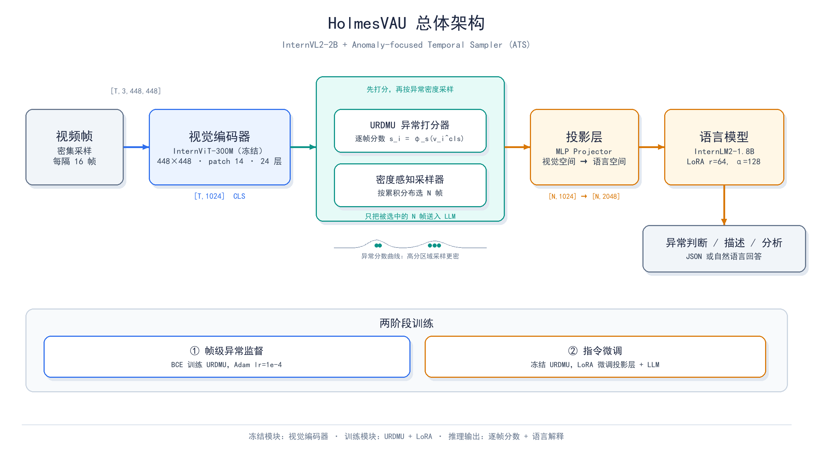
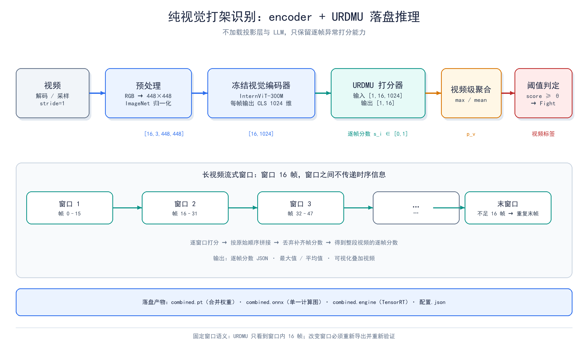
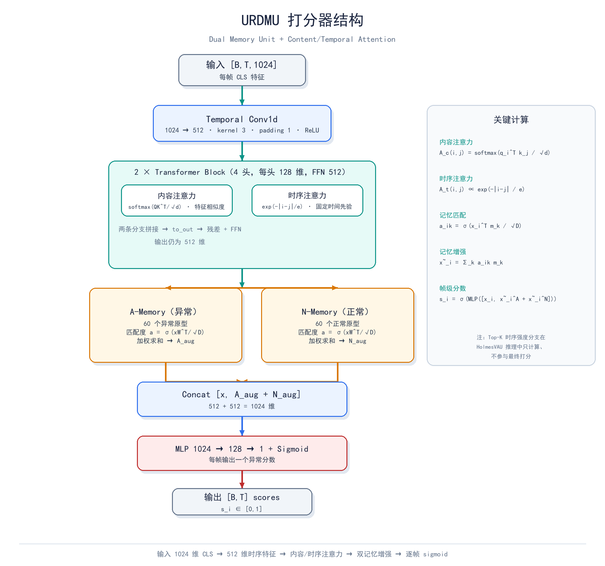
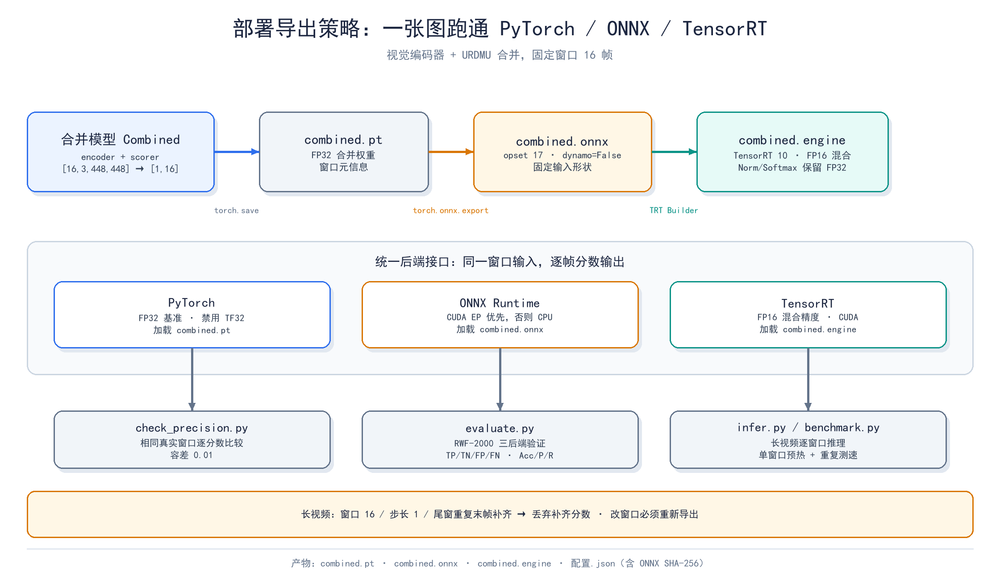

> HolmesVAU-2B（InternVL2-2B + ATS/URDMU）实践笔记：从视频异常理解，到边缘端可部署的打架识别。
>
> 内容覆盖：模型原理与结构、encoder + URDMU 落盘方案、ONNX/TensorRT 部署策略，以及 X3D 与人体骨架两条路线的复盘。

---

## Table of contents

## 0. 先说结论

这篇文章想回答三个问题：

1. HolmesVAU 到底是什么，它的“异常感知”能力从哪来？
2. 为什么这个项目最终没有把 2B 大模型整套搬上边缘端，而是只保留 **视觉编码器 + URDMU 打分器**？
3. 在真正落地之前，我们试过的 X3D 和人体骨架两条路线，为什么在 RWF-2000 上看起来“能跑”，到了真实长视频里却不好用？

先把最重要的数字放在前面。以下结果都来自本项目的历史实验记录，口径不同，不能混在一起比较：

| 路线                            | 输入/输出                   | RWF-2000 验证集表现                                    | 结论                                                     |
| ------------------------------- | --------------------------- | ------------------------------------------------------ | -------------------------------------------------------- |
| 完整 HolmesVAU-2B               | 视频 + 文本提示 → JSON 判断 | **90.23%**（399/400，precision 90.05%，recall 90.50%） | 效果最好，但 2B 参数、需要 LLM，边缘端不划算             |
| 纯视觉：原始 URDMU              | 16 帧窗口 → 16 个异常分数   | 80.75%（阈值 0.5，max 聚合）                           | 能跑，但“通用异常”不等于“打架”                           |
| 纯视觉：冻结编码器 + 微调 URDMU | 16 帧窗口 → 16 个异常分数   | 86.50%（整段 16 帧口径）；窗口 16 为 86.25%            | **本项目最终主路线**                                     |
| X3D-M                           | 76 帧片段 → Fight/NonFight  | 88.00%（best epoch 21）                                | 分数不差，但窗口级输出、时序尺度错位、真实长视频误报严重 |
| 人体骨架 + ConvLSTM             | 51 帧骨架/帧差 → 暴力概率   | 89.25%（RTMO）；端到端 89.50%                          | 精度接近论文，但检测器是瓶颈，拥挤/低清场景易失效        |

一句话总结：

> **HolmesVAU 的视觉主干提供了很强的通用异常表征，URDMU 把这些表征变成逐帧分数；冻结编码器、只微调打分器，是在“效果、体积、可部署性”之间最划算的折中。X3D 和骨架方案不是“精度不够”，而是“输出语义、时序尺度和工程代价”不适合这个产品。**

---

## 1. HolmesVAU 模型：原理与结构

### 1.1 它解决的不是“分类”，而是“理解”

传统视频异常检测（VAD）通常只做一件事：给每一帧打一个异常分，告诉你是正常还是异常。它不解释“发生了什么”，也不区分“打架”“盗窃”“爆炸”。

HolmesVAU 的目标是 **Video Anomaly Understanding（VAU）**：

- 既要定位异常发生在哪些帧；
- 又要用自然语言说明异常是什么、为什么判断为异常。

为此，论文构建了 **HIVAU-70k** 数据集，把标注分成三个层级：

| 层级            | 关注点       | 典型能力                           |
| --------------- | ------------ | ---------------------------------- |
| Clip（片段级）  | 短时视觉感知 | 画面里有什么人、什么动作、什么场景 |
| Event（事件级） | 完整异常事件 | 判断“这是不是异常”“属于哪一类”     |
| Video（视频级） | 长时上下文   | 解释因果、总结整个视频的异常过程   |

这也是 HolmesVAU 和普通 VAD 最大的区别：它不是只学“异常分数”，而是同时学“异常语义”。

### 1.2 总体结构：InternVL2-2B + ATS

HolmesVAU 的主体是 **InternVL2-2B**，再外挂一个 **Anomaly-focused Temporal Sampler（ATS，异常聚焦时序采样器）**。

```text
视频帧
  │
  ▼
┌─────────────────────────────┐
│ 视觉编码器 InternViT-300M    │  冻结
│ 448×448，patch 14，24 层     │
│ 输出 CLS + patch tokens      │
└──────────────┬──────────────┘
               │  v_i^cls ∈ R^1024
               ▼
┌─────────────────────────────┐
│ ATS                          │
│  ├─ 异常打分器 URDMU          │  逐帧异常分数 s_i
│  └─ 密度感知采样器            │  按分数累积分布选 N 帧
└──────────────┬──────────────┘
               │  被选中的帧特征
               ▼
┌─────────────────────────────┐
│ 投影层 MLP Projector          │  视觉空间 → 语言空间
└──────────────┬──────────────┘
               │
               ▼
┌─────────────────────────────┐
│ 语言模型 InternLM2-1.8B       │  LoRA 微调
│ + 文本提示                    │
└──────────────┬──────────────┘
               │
               ▼
        异常判断 / 描述 / 分析
```

从配置上看，这个 2B 模型的几个关键参数是：

| 模块       | 关键配置                                                                |
| ---------- | ----------------------------------------------------------------------- |
| 视觉编码器 | InternViT-300M，hidden 1024，24 层，16 头，patch 14，输入 448×448       |
| 视觉 token | 448/14 = 32×32 = 1024 个 patch token，外加 1 个 CLS token               |
| 投影层     | MLP + pixel shuffle（`downsample_ratio=0.5`），把视觉特征映射到语言空间 |
| 语言模型   | InternLM2-1.8B，hidden 2048，24 层，16 头，8 个 KV 头                   |
| 微调方式   | 视觉编码器冻结；LLM 使用 LoRA（r=64，α=128，lr=4e-5）                   |
| 异常打分器 | URDMU，输入 1024 维 CLS 特征，输出逐帧异常分数                          |

注意：在纯视觉部署里，**投影层和 LLM 都不加载**，只保留视觉编码器和 URDMU。这是后面所有部署优化的前提。



_图 1：HolmesVAU 由 InternViT、ATS（URDMU + 密度感知采样）、投影层和 InternLM2 组成；纯视觉部署只保留前半部分。_

### 1.3 ATS 的核心：先打分，再“按异常密度采样”

HolmesVAU 认为，长视频里大部分帧是冗余的，真正有信息的异常帧很少。均匀采样容易漏掉关键帧，Top-K 采样又容易只盯着局部异常、丢掉上下文。

于是 ATS 分成两步。

#### 第一步：异常打分器给每帧打分

设第 `i` 帧经过视觉编码器得到的 CLS 特征为 `v_i^cls ∈ R^1024`，异常打分器为 `φ_s`，则：

```text
s_i = φ_s(v_i^cls),   s_i ∈ [0,1]
```

这里的 `s_i` 是“异常分数”，不是“打架概率”。它只知道“这帧和正常模式偏离多少”，不知道异常具体是打架、盗窃还是爆炸。

#### 第二步：密度感知采样

把异常分数看成一个概率质量函数，沿时间轴累加，得到累积分布：

```text
C(t) = Σ_{i=1..t} (s_i + τ)
```

其中 `τ` 是平滑项，论文测试时取 `τ = 0.1`。`τ` 的作用是避免所有分数都接近 0 时累积分布过于陡峭，控制采样的均匀程度。

然后在累积轴上均匀取 `N` 个点：

```text
u_j = 1 + (C(T) - 1) * (j - 1) / (N - 1),   j = 1..N
```

再通过反函数映射回时间轴，找到最近的帧索引：

```text
g_j = C^(-1)(u_j)
```

最终得到采样帧集合 `G = {g_1, ..., g_N}`。

工程实现里还有一个兜底：如果总帧数不超过 `N`，或者所有异常分数之和小于 1，就退化为均匀采样，避免累积分布过于平坦导致反函数不稳定。

直观理解：

- 异常分数高的时间段，累积曲线上升快，同样的累积步长会覆盖更少的时间，于是采样点更密；
- 异常分数低的时间段，累积曲线上升慢，采样点更稀；
- 既不会像 Uniform 那样漏掉异常，也不会像 Top-K 那样只采集异常尖峰、丢掉前后文。

论文里 `N` 通常取 8/16/32，实验显示 ATS 在不同帧数下都优于 Uniform 和 Top-K。

#### 第三步：送进 LLM

被选中的帧特征经过投影层 `φ_p` 映射到语言空间，再和文本提示的 token 拼接：

```text
X_ins = cat[ φ_p(cat[V_i]), X_q ],   i ∈ G
```

最后让 LLM 自回归地生成回答：

```text
p(X_a | X_ins) = Π_{i=1..L} p_θ(x_i | X_ins,<i, X_a,<i)
```

其中 `X_q` 是文本提示，`X_a` 是目标回答，`θ` 是可训练参数（实际用 LoRA）。

### 1.4 两阶段训练

HolmesVAU 的训练分两步，这一点很重要，因为它解释了为什么“打分器”可以单独拿出来用。

#### 阶段一：训练异常打分器

使用 HIVAU-70k 的帧级标签 `ŷ_i ∈ {0,1}`，对打分器做二分类训练：

```text
L_AS = -Σ_{i=1..T} [ ŷ_i log s_i + (1 - ŷ_i) log(1 - s_i) ]
```

这里 `s_i` 是模型输出的异常分数，`ŷ_i` 是帧级标签。论文原文的公式把 `s_i` 和 `ŷ_i` 写反了位置，按二分类交叉熵的标准写法应以上式为准。

这一步让 URDMU 学会“什么样的帧更像异常”。训练时使用 Adam，学习率 `1e-4`。

#### 阶段二：冻结打分器，指令微调 LLM

打分器固定后，用 HIVAU-70k 的指令数据训练投影层和 LLM（LLM 用 LoRA）。目标是让模型学会：

- 判断有没有异常；
- 描述异常是什么；
- 分析为什么是异常。

这一步的损失是标准的自回归交叉熵：

```text
L_LM = -Σ_{i=1..L} log p_θ(x_i | X_ins,<i, X_a,<i)
```

### 1.5 为什么 HolmesVAU 能用来做“打架”

有三个原因：

1. **视觉主干强**：InternViT 在大量图文/视频数据上预训练，对人物、动作、场景有很好的通用表征。
2. **打分器是帧级的**：URDMU 输出逐帧分数，天然适合做时序定位，而不是只给视频一个标签。
3. **指令数据里有打架**：HIVAU-70k 覆盖 UCF-Crime 和 XD-Violence 的 Fighting/Assault/Abuse 等类别，模型见过“人际暴力”的语义。

但必须强调：**HolmesVAU 的异常分数是通用异常分数，不是打架专用概率。** 盗窃、事故、爆炸、甚至剧烈的正常运动，都可能得到高分。这一点在后面的实验中会反复出现。

### 1.6 数据说明：HolmesVAU 见过什么，不代表它只见过什么

HolmesVAU 在 UCF-Crime 和 XD-Violence 等视频异常数据集上进行基准评测。下面是数据集常见类别，列出评测数据集不意味着它们就是当前权重的全部训练数据。

| 数据集      | 类别                                                                                                                                                                                                                                                                           |
| ----------- | ------------------------------------------------------------------------------------------------------------------------------------------------------------------------------------------------------------------------------------------------------------------------------ |
| UCF-Crime   | 正常视频；Abuse（虐待）、Arrest（逮捕）、Arson（纵火）、Assault（袭击）、Burglary（入室盗窃）、Explosion（爆炸）、Fighting（打架）、RoadAccidents（道路事故）、Robbery（抢劫）、Shooting（枪击）、Shoplifting（商店盗窃）、Stealing（偷窃）、Vandalism（故意破坏）等 13 类异常 |
| XD-Violence | A：正常场景；B：打架（Fighting）；C：枪击（Shooting）；D：骚乱（Riot，原文笼统称“冲突”）；E：虐待（Abuse）；F：交通事故（Car Accident）；G：爆炸（Explosion）                                                                                                                  |
| RWF-2000    | Fight（打架）与 NonFight（非打架），用于本目录的专项微调和验证                                                                                                                                                                                                                 |

因此，直接把通用异常分数作为打架分数时，盗窃、事故、爆炸等其他异常可能产生误报。专项微调和 RWF-2000 验证可以衡量打架分类表现，但不能把通用异常检测自动等同于打架专用分类。

### 1.7 本项目的取舍：为什么只留 encoder + scorer

完整 HolmesVAU 的推理链路是：

```text
解码视频 → 视觉编码 → ATS 采样 → 投影 → LLM 生成
```

在边缘端，这条链路有三个硬伤：

| 问题       | 具体表现                                              |
| ---------- | ----------------------------------------------------- |
| 参数大     | 完整模型约 2B，权重约 4.4 GB（FP16），显存/内存压力大 |
| 延迟高     | LLM 自回归生成，首 token 延迟和总生成时间都不可控     |
| 输出不稳定 | 自然语言输出需要解析，格式错误要重试，不适合硬实时    |

而打架识别真正需要的，其实只是：

```text
视频帧 → 视觉编码 → 逐帧异常分数 → 阈值/聚合 → 打架判定
```

所以本项目做了一个非常工程化的裁剪：

- **保留**：视觉编码器（InternViT-300M）+ URDMU 打分器（约 650 万参数）；
- **去掉**：投影层、LLM、tokenizer、文本提示、自然语言生成；
- **结果**：模型从 2B 降到约 3 亿参数级别，计算图变成纯前馈，天然适合 ONNX/TensorRT。

代价是：失去了 LLM 的语义推理能力，分数不再是“打架专用”，需要靠微调和校准来补。

---

## 2. 打架算法方案：落盘 encoder + 打分器

这一章是本项目的核心。我们把它拆成“数据怎么进、特征怎么出、分数怎么算、模型怎么训、结果怎么读”五个部分。

### 2.1 方案总览

```text
视频
 │
 ├─ 解码（decord / FFmpeg 兼容性回退）
 │
 ├─ 采样：默认 stride=1，逐帧或按间隔取帧
 │
 ├─ 预处理：RGB → 448×448 → ImageNet 归一化 → [16,3,448,448]
 │
 ├─ 视觉编码器（冻结）：每帧输出 CLS 特征 [16,1024]
 │
 ├─ URDMU 打分器：输入 [1,16,1024] → 输出 [1,16]
 │
 ├─ 后处理：逐帧分数 → 视频分数（max / mean）
 │
 └─ 判定：video_score >= threshold → Fight
```

关键张量形状：

| 阶段           | 形状                | 含义                       |
| -------------- | ------------------- | -------------------------- |
| 输入 `pixels`  | `[16, 3, 448, 448]` | 16 帧，RGB，已归一化，FP32 |
| 视觉编码器 CLS | `[16, 1024]`        | 每帧一个 1024 维特征       |
| URDMU 输入     | `[1, 16, 1024]`     | 一个视频窗口的时序特征     |
| URDMU 输出     | `[1, 16]`           | 每帧一个异常分数           |

这里的 16 有两个身份：

- 在视觉编码器里，它是 **帧批大小**；
- 在 URDMU 里，它是 **时序长度**。

它不是“16 个视频的批大小”。不同视频的帧不能混进同一个时序窗口，否则 URDMU 会把不同视频的帧当成一个连续序列，产生完全无意义的时序关系和分数。



_图 2：纯视觉链路只保留“解码/采样 → 预处理 → 冻结编码器 → URDMU → 聚合/阈值”，长视频按 16 帧窗口流式执行。_

### 2.2 预处理：越简单越不容易出错

纯视觉路径的预处理和完整模型基本一致，但做了一个重要简化：**每帧只取一个 448×448 tile**。

具体步骤：

1. `decord` 读帧，得到 RGB `uint8`；
2. `PIL.Image.fromarray(...).convert('RGB')`；
3. `dynamic_preprocess(..., image_size=448, use_thumbnail=True, max_num=1)`；
4. `build_transform(448)`：
   - `Resize((448,448), BICUBIC)`；
   - `ToTensor()`；
   - `Normalize(mean=(0.485,0.456,0.406), std=(0.229,0.224,0.225))`；
5. 堆叠成 `[T,3,448,448]`。

为什么 `max_num=1`？

完整 InternVL 支持动态切图（把大图切成多个 448×448 tile），但纯视觉路径只需要一个 CLS 特征，切图会引入额外 token 和计算量，而且不同帧的 tile 数可能不一致，反而增加工程复杂度。所以这里固定单 tile。

### 2.3 视觉编码器：只读 `vision_model.*`

加载逻辑在 `deploy/utils.py` 的 `load_vision()` 里，做了三件事：

1. 从模型目录读 `config.json`，拿到 `vision_config`；
2. 用 `get_class_from_dynamic_module('modeling_intern_vit.InternVisionModel', ...)` 动态加载视觉类；
3. 从 `model.safetensors`（或分片索引）里只取 `vision_model.*` 权重，去掉前缀后严格加载。

这样做的好处：

- 不加载 LLM、不加载 tokenizer、不加载投影层；
- 不会因为 LLM 权重缺失或版本不兼容而失败；
- 视觉权重严格校验，避免“少加载几层还能跑”的隐性错误。

视觉编码器的输出：

```text
H = φ_v(pixels),   v_i^cls = H_i[:,0,:] ∈ R^1024
```

注意：在纯视觉路径里，视觉编码器是 **冻结** 的。它只做特征提取，不参与打架任务的梯度更新。

### 2.4 URDMU 打分器：一个小而全的时序网络

URDMU 来自 UR-DMU（AAAI 2023），结构不复杂，但几个设计很关键：



_图 3：URDMU 用“时序卷积 + 内容/时序双分支注意力 + 异常/正常双记忆 + 逐帧分类头”把 CLS 特征变成异常分数。_

```text
输入 [B,T,1024]
  │
  ├─ Temporal Conv1d(1024→512, k=3, p=1) + ReLU
  │
  ├─ 2 × Transformer Block（4 头，每头 128 维，FFN 512，dropout 0.5）
  │     ├─ PreNorm + Attention
  │     └─ PreNorm + FeedForward
  │
  ├─ A-Memory（60 个异常记忆槽）
  ├─ N-Memory（60 个正常记忆槽）
  │
  ├─ concat[x, A_aug + N_aug] → 1024 维
  │
  └─ MLP(1024→128→1) + Sigmoid → 每帧异常分数
```

#### 2.4.1 时序卷积

第一层是 `Conv1d(kernel_size=3, padding=1)`，它在时间维上做局部聚合：

```text
x_t = ReLU( Σ_{k=-1..1} W_k v_{t+k}^cls + b )
```

这一步把 1024 维降到 512 维，同时让每个帧的特征带上一小段邻域信息。

#### 2.4.2 双分支注意力：内容 + 时序

URDMU 的 Attention 不是标准自注意力，而是把 Q、K、V、T 一起投影出来：

```text
[q, k, v, t] = chunk(W_qkvt x, 4)
```

然后分成两条分支。

**内容注意力**：看帧与帧之间的特征相似度。

```text
A_c_h(i,j) = exp(q_i^T k_j / √d_h) / Σ_j' exp(q_i^T k_j' / √d_h)
```

```text
o_c_i = Σ_j A_c_h(i,j) v_j
```

**时序注意力**：不看内容，只看帧之间的时间距离，距离越近权重越大。

```text
A_t(i,j) = exp(-|i-j| / e) / Σ_j' exp(-|i-j'| / e)
```

```text
o_t_i = Σ_j A_t(i,j) t_j
```

其中 `e = 2.718281828459045`，对应原实现的 `exp(1)`。这是一个固定的时序先验，不参与学习。

最后把两条分支拼起来，再投影回 512 维：

```text
o_i = Concat(o_c_i, o_t_i),   y_i = W_o o_i + b_o
```

这比标准自注意力多了一条“时间距离”通路，对打架这种强时序动作很有用：出拳、推搡、倒地，都是短时间内的连续动作。

#### 2.4.3 双记忆单元：异常记忆 + 正常记忆

URDMU 维护两个记忆库：

- `A-Memory`：60 个异常原型；
- `N-Memory`：60 个正常原型。

对每个帧特征 `x_i`，计算它和记忆槽 `m_k` 的匹配度：

```text
a_i,k = σ( x_i^T m_k / √D )
```

然后做加权求和，得到记忆增强特征：

```text
x~_i = Σ_k a_i,k m_k
```

原实现还会对匹配度做 Top-K 池化，得到一个“时序异常强度”：

```text
ã_i = mean( TopK(a_i,·, K) )
```

其中 `K = floor(60/16) + 1 = 5`。不过在 HolmesVAU 的推理路径里，这个分支只计算、不参与最终打分，真正送进分类头的是记忆增强特征。

#### 2.4.4 分类头

把原始特征和两路记忆增强特征拼起来：

```text
z_i = Concat[ x_i, x~_i^A + x~_i^N ] ∈ R^1024
```

再过一个小 MLP：

```text
s_i = σ( W_2 ReLU(W_1 z_i + b_1) + b_2 )
```

其中 `W_1: 1024 → 128`，`W_2: 128 → 1`。输出 `s_i ∈ [0,1]`，就是第 `i` 帧的异常分数。

### 2.5 窗口语义：16 帧不是“随便定的”

部署时默认窗口是 16 帧。这个 16 不是视频批大小，而是 URDMU 一次能看到的最大时序长度。

长视频的处理方式是流式窗口：

```text
总帧数 N，窗口 W=16，步长 S=1（默认）

窗口 1：帧 0..15
窗口 2：帧 16..31
窗口 3：帧 32..47
...
末窗口：不足 16 帧，重复最后一帧补齐
```

对末窗口：

```text
W~ = W || {last frame}^{16-|W|}
```

补齐后送进模型，输出 16 个分数，但只保留真实帧对应的前 `|W|` 个分数，补齐部分的分数丢弃。

这里有一个非常重要的语义差别：

> **固定 16 帧窗口 ≠ 先把整个视频的视觉特征拼起来，再一次性送进 URDMU。**

URDMU 的时序卷积和注意力只能看到窗口内的 16 帧。窗口之间没有信息传递。所以：

- 窗口内的时序上下文是完整的；
- 窗口之间的长时依赖是缺失的；
- 改变窗口大小会改变打分语义，分数不能直接比较。

这也是为什么 README 反复强调：**不要混合多个视频的帧作为一个窗口；改变窗口要重新导出并重新验证。**

### 2.6 视频级聚合与判定

URDMU 输出的是逐帧分数，但 RWF-2000 的标签是视频级的。所以需要一个聚合方式：

```text
p_v = max_{i∈V} s_i
```

默认用 `max`，也可以用 `mean`。`max` 的直觉是：只要视频里有一帧明显像打架，就判为打架。它对短时暴力更敏感，但也更容易被单帧误检带偏。

判定规则：

```text
ŷ = 1,  if p_v ≥ θ
ŷ = 0,  if p_v < θ
```

默认 `θ = 0.5`。注意：这个 0.5 是**预先固定的阈值**，不是在验证集上挑出来的。README 明确要求：不能用验证集标签调阈值，否则指标会有偏。

评价指标：

```text
Accuracy = (TP + TN) / (TP + TN + FP + FN)
```

```text
Precision = TP / (TP + FP),   Recall = TP / (TP + FN)
```

其中 Fight 是正类，NonFight 是负类。

### 2.7 冻结视觉编码器微调：只训练打分器

原始 URDMU 是在通用异常数据上训练的，直接拿来当打架分数，会有两个问题：

1. 它不知道“打架”这个具体语义；
2. 它的分数分布和 RWF-2000 的数据分布不匹配。

所以本项目提供了一个轻量微调流程：**冻结视觉编码器，只训练 URDMU**。

#### 2.7.1 数据划分

使用 RWF-2000 官方 train（1600 段），按原始视频来源分组：

- 每类随机 20% 的来源划入内部校准集；
- 剩余 80% 用于训练；
- **同一来源不会同时出现在训练集和校准集**，避免同一演员/同一场景泄漏。

实际划分为：

| 集合        | 视频数 | 用途                           |
| ----------- | -----: | ------------------------------ |
| train       |   1164 | 更新打分器参数                 |
| calibration |    436 | 选最佳轮次、选阈值             |
| val         |    400 | 最终评估，完全不参与训练和调参 |

#### 2.7.2 特征提取与缓存

每个视频在完整时间范围内均匀采样 16 帧（短视频允许重复帧），只提取冻结编码器的 FP32 CLS 特征，并缓存到：

```text
deploy/features/finetuning
```

缓存标识包含：

- 编码器权重摘要；
- 采样设置；
- 预处理方式；
- 脚本代码版本。

这样换权重、换采样、换预处理时，缓存会自动失效，不会拿旧特征训练新模型。

#### 2.7.3 训练目标

视频级标签 `y ∈ {0,1}`，视频分数用最大帧分数：

```text
p_v = max_{t=1..T} s_t
```

损失：

```text
L_vid = -[ y log p_v + (1 - y) log(1 - p_v) ]
```

如果用 `--aggregation mean`，则：

```text
p_v = (1/T) Σ_{t=1..T} s_t
```

优化器与超参数：

| 参数             | 默认值 |
| ---------------- | ------ |
| 优化器           | AdamW  |
| 学习率           | `1e-5` |
| 权重衰减         | `1e-4` |
| 梯度裁剪         | 5      |
| 轮数             | 20     |
| 训练视频批大小   | 16     |
| 采样帧数         | 16     |
| 特征提取帧批大小 | 16     |

#### 2.7.4 模型选择与阈值校准

- 每个 epoch 在内部校准集上算 ROC-AUC；
- 选 ROC-AUC 最高的轮次；
- 如果并列，选校准损失更小的；
- 阈值只在内部校准集上选，目标是平衡准确率；
- 官方 val 只做最终评估。

本次实验中，校准集选出的阈值是：

```text
θ* = 0.7915438413619995
```

这个阈值比 0.5 高不少，说明微调后的打分器整体分数偏高，需要更严格的判定线。

#### 2.7.5 冻结核验

训练结束必须确认三件事：

1. encoder 权重前后摘要完全一致；
2. 所有 encoder 梯度为空；
3. 打分器参数确实发生了更新。

本次实验的核验结果：

- `encoder权重前后摘要一致 = true`；
- `encoder摘要 = 2bb4300f...`；
- 更新参数全部是 `scorer.*`，包括 `embedding`、`self_attn`、`cls_head`、`Amemory`、`Nmemory`、`encoder_mu`；
- 未使用的 `encoder_var` 分支也被冻结。

#### 2.7.6 微调结果

本次微调在 400 个官方 val 视频上的结果：

| 模型       |           阈值 |   Accuracy | Precision | Recall |         F1 |    ROC-AUC |         AP |
| ---------- | -------------: | ---------: | --------: | -----: | ---------: | ---------: | ---------: |
| 原始打分器 |            0.5 |     79.25% |    80.95% | 76.50% |     0.7866 |     0.8890 |     0.8871 |
| 微调打分器 |            0.5 | **86.50%** |    85.78% | 87.50% | **0.8663** | **0.9358** | **0.9285** |
| 微调打分器 | 0.7915（校准） |     83.75% |    87.71% | 78.50% |     0.8285 |     0.9358 |     0.9285 |

这张表很有意思：

- 固定 0.5 时，微调把准确率从 79.25% 拉到 86.50%，说明打分器确实学到了打架相关的模式；
- 校准阈值 0.7915 更保守，precision 更高，但 recall 下降，适合“宁可少报、不要误报”的场景；
- **阈值不是越高越好，要看业务更怕 FP 还是 FN。**

### 2.8 不同窗口与不同打分器的对比

RWF-2000 验证集上，纯视觉路线的多组实验结果：

| 配置         | 打分器 |      窗口 |   Accuracy | Precision | Recall | 说明                     |
| ------------ | ------ | --------: | ---------: | --------: | -----: | ------------------------ |
| 整段一次打分 | 原始   | 0（整段） |     80.75% |    76.39% | 89.00% | 原始 URDMU，通用异常分数 |
| 窗口 20      | 原始   |        20 |     80.25% |    75.97% | 88.50% | 窗口改变后语义变化       |
| 整段一次打分 | 微调   | 0（整段） | **86.50%** |    83.80% | 90.50% | 微调后最佳整段结果       |
| 窗口 20      | 微调   |        20 |     85.00% |    80.97% | 91.50% | 窗口 20 略低于整段       |
| 窗口 16      | 微调   |        16 | **86.25%** |    83.11% | 91.00% | 与部署窗口一致，推荐     |

> 口径提醒：2.7.6 里原始打分器的 79.25% 是“整段均匀采样 16 帧”的微调评估口径；2.8 里原始打分器的 80.75% 是“部署口径逐帧采样 + 多窗口 + max 聚合”的评估口径。两者不是同一套采样，不能直接相减。微调后的 86.50% 与 86.25% 也分别对应整段 16 帧和窗口 16 两种上下文。

可以看到：

- 微调带来的提升（约 +6 个百分点）远大于窗口调整带来的波动；
- 窗口 16 和整段打分的差距只有 0.25 个百分点，说明 16 帧窗口是一个不错的工程折中；
- 窗口 20 在微调模型上反而略低，说明“窗口不是越大越好”，要和训练时的时序上下文匹配。

### 2.9 完整模型 vs 纯视觉

完整模型的推理策略和纯视觉不同：

- 视频长度超过 `16 × 12 = 192` 帧时，采用 URDMU 引导的 ATS：先每 16 帧密集采样，再由打分器选出 12 帧送进 LLM；
- 视频不超过 192 帧时，按原项目逻辑均匀采样 12 帧；
- 提示词要求模型根据画面识别人际真实肢体暴力，并返回包含布尔字段“打架暴力”的 JSON；
- 解析时严格找 JSON 对象，不使用“打架”关键词匹配，避免把“没有打架”误判为正类；
- 格式不合法时重试一次，仍失败则记录错误，不默认当作负类。

同一个 RWF-2000 验证集上，完整 HolmesVAU 和纯视觉的对比：

| 路线                | 成功视频数 |   Accuracy | Precision | Recall | 说明                   |
| ------------------- | ---------: | ---------: | --------: | -----: | ---------------------- |
| 完整 HolmesVAU-2B   |    399/400 | **90.23%** |    90.05% | 90.50% | 有 LLM，输出 JSON 判断 |
| 纯视觉 + 微调 URDMU |    400/400 |     86.50% |    83.80% | 90.50% | 无 LLM，逐帧分数       |
| 纯视觉 + 原始 URDMU |    400/400 |     80.75% |    76.39% | 89.00% | 通用异常分数           |

完整模型高出的约 3.7 个百分点，主要来自 LLM 的语义推理：它能区分“打架”和“搬运货物”“体育对抗”“嬉戏”等视觉上相似但语义不同的行为。纯视觉模型没有这层能力，只能靠异常分数和微调去逼近。

但完整模型的代价是：

- 2B 参数、4.4 GB 权重；
- 需要 GPU 显存；
- 需要 LLM 解码；
- 输出需要解析，格式错误要重试。

所以本项目的选择是：**用 3 亿参数级别的纯视觉模型，换取可部署性和确定性；用冻结编码器微调，把精度从 80.75% 拉到 86.25%。**

### 2.10 方案边界：这些坑必须提前知道

1. **通用异常 ≠ 打架**
   - 盗窃、事故、爆炸、剧烈运动都可能高分；
   - RWF-2000 上的 86% 不代表真实监控场景的 86%。

2. **窗口上下文有限**
   - 16 帧窗口之间没有信息传递；
   - 长视频的“前因后果”看不到；
   - 改变窗口大小要重新验证。

3. **阈值不能乱调**
   - 不能用验证集标签选阈值；
   - 微调模型的校准阈值是 0.7915，不是 0.5；
   - 部署脚本不会自动读权重里的阈值，必须显式传。

4. **短视频要补帧**
   - 不足 16 帧时重复最后一帧；
   - 补齐帧的分数要丢弃，不能参与视频分数。

5. **不同视频不能混窗口**
   - URDMU 的时序注意力会把不同视频的帧当成一个序列；
   - 必须一个视频一个窗口。

---

## 3. 部署导出策略：把 2B 模型压成一张能用 TensorRT 跑的图

这一章对应 `deploy/README.md` 的完整内容。我们不仅给出命令，也解释“为什么这么做”。

### 3.1 目标与约束

部署目标：

- 不加载 LLM、不加载投影层；
- 视觉编码器 + URDMU 合并为一个计算图；
- 固定输入形状，便于 ONNX/TensorRT 优化；
- 支持 PyTorch / ONNX / TensorRT 三个后端；
- 长视频流式处理，内存不随视频长度增长；
- 输出逐帧分数，支持可视化和验证。

约束：

- 窗口形状固定，改变窗口要重新导出；
- TensorRT 引擎必须在目标 GPU 和兼容的 TensorRT 环境中构建；
- FP16 是混合精度，不是所有层都半精度；
- 分数是通用异常分数，不是打架专用概率。

### 3.2 合并纯视觉模型部署

将视觉编码器与 URDMU 合并为一个计算图，不包含投影层和 LLM。

默认输入：

- 同一视频按时间顺序排列的 16 帧；
- 形状 `[16,3,448,448]`；
- 取视觉 CLS 特征 `[16,1024]`；
- 转换为 `[1,16,1024]` 送入时序打分器；
- 输出 `[1,16]`。

默认逐帧采样，长视频逐窗口执行，内存不随视频长度累计图像张量。结果 JSON 保存逐帧分数，因此其大小随视频长度增长。

固定窗口与此前“分批编码后拼接整个视频再打分”不是相同语义。URDMU 时序卷积和注意力仅看到窗口内的帧；末窗口重复末帧补齐，再丢弃补齐分数。不要混合多个视频的帧作为一个窗口。分数为通用异常分数，不是打架专用概率；验证使用最大分数聚合，默认阈值 0.5，不使用验证标签选择阈值。

### 3.3 合并模型导出与 TensorRT FP16 精度说明

本节说明 `export.py` 的导出流程、`utils.py` 中 `export_attention()` 的作用，以及如何验证 TensorRT FP16 是否影响分类指标。

#### 3.3.1 模型输入与导出流程

视觉编码器和 URDMU 打分器合并为一个模型，不包含 LLM 和视觉投影层。默认窗口为同一视频按时间顺序排列的 16 帧。

| 阶段                | 张量形状            | 含义                                          |
| ------------------- | ------------------- | --------------------------------------------- |
| 输入 `pixels`       | `[16, 3, 448, 448]` | 已完成 RGB 转换、缩放和归一化的 FP32 图像张量 |
| 视觉编码器 CLS 特征 | `[16, 1024]`        | 每帧一个特征向量                              |
| URDMU 输入          | `[1, 16, 1024]`     | 一个视频窗口的时序特征                        |
| 输出 `scores`       | `[1, 16]`           | 逐帧异常分数                                  |

16 在视觉编码器中是帧批大小，在 URDMU 中是时序长度；它不是 16 个视频的批大小。不同视频的帧不能直接放入同一个时序窗口。

`export.py` 依次执行以下操作：

1. 加载视觉编码器和 URDMU 权重，以评估模式构建合并模型。
2. 保存合并 PyTorch 权重。
3. 使用固定输入形状导出 ONNX，算子集版本为 17，使用传统导出路径 `dynamo=False`。
4. 使用 ONNX 检查器检查图结构。
5. 从同一个 ONNX 图构建 FP16 混合精度 TensorRT 引擎。
6. 保存窗口、模型来源、精度说明和 ONNX SHA-256 摘要。

产物默认位于 `deploy/artifacts/`：

| 文件              | 用途                                  |
| ----------------- | ------------------------------------- |
| `combined.pt`     | 合并 PyTorch 模型的状态字典及窗口信息 |
| `combined.onnx`   | 包含视觉编码器和 URDMU 的单一计算图   |
| `combined.engine` | 在目标 GPU 上构建的 TensorRT 引擎     |
| `配置.json`       | 部署配置与 ONNX 摘要                  |

ONNX 和引擎的窗口形状固定。更改窗口需要重新导出并构建；推理参数必须与产物配置一致。长视频按窗口依次执行，末窗口不足时重复末帧补齐，输出时丢弃补齐帧的分数。



_图 4：合并模型先落盘为 PyTorch 权重，再导出 ONNX、构建 TensorRT FP16 引擎，最后用同一窗口输入做三后端精度与指标验证。_

本项目实际产物的大小（本机实测，仅作参考）：

| 文件              |       大小 |
| ----------------- | ---------: |
| `combined.pt`     | 约 1.24 GB |
| `combined.onnx`   | 约 1.24 GB |
| `combined.engine` |  约 631 MB |

相比完整 2B 模型约 4.4 GB 的权重，纯视觉合并图的体积约为其 28%，参数量从约 2B 降到约 3 亿。注意 `combined.pt` 是 FP32 合并权重，所以文件仍有 1.24 GB；真正上边缘端时，TensorRT FP16 引擎约 631 MB，更适合受限设备。

#### 3.3.2 导出和验证命令

在项目根目录（README 里写作 `/code/HolmesVAU`，本机为项目根目录）下运行，环境需要 PyTorch、Transformers、ONNX、TensorRT 10 和 CUDA；数值检查还需要 ONNX Runtime 和视频读取依赖。

```bash
# 默认窗口16，保存PyTorch权重、导出ONNX并构建TensorRT引擎。
CUDA_VISIBLE_DEVICES=0 bash deploy/run_export.sh --window 16

# 复用已有ONNX，只重新构建引擎；窗口必须匹配。
CUDA_VISIBLE_DEVICES=0 python deploy/export.py --window 16 --build-only

# 用相同真实视频窗口比较三个后端的逐帧分数。
CUDA_VISIBLE_DEVICES=0 python deploy/check_precision.py \
  --video datasets/RWF-2000/val/Fight/0Ow4cotKOuw_0.avi

# 三后端完整验证；数据集需先解压到datasets/RWF-2000/val。
CUDA_VISIBLE_DEVICES=0 bash deploy/run_evaluate.sh
```

参数说明：

- `--window` 的别名为 `--batch-size`，默认 16；
- `--workspace` 默认 4，单位为 GB；
- `--artifacts` 可指定产物目录；
- `--model` 和 `--scorer` 可指定权重来源；
- 引擎应在目标 GPU 和兼容的 TensorRT 环境中构建。

`--build-only` 会复用已有 ONNX，只重新构建引擎，并检查 ONNX 输入形状是否与窗口一致。

> 代码现状提醒：当前仓库里的 `deploy/export.py` 把 `--build-only` 的 `default` 写成了 `True`，因此直接运行 `python deploy/export.py --window 16` 实际会走“复用已有 ONNX、只重建引擎”的分支；`run_export.sh` 和 `run_all.sh` 也会受此影响。首次导出、或需要重新生成 ONNX 时，应先把该默认值改为 `False`，或给脚本增加一个显式的导出开关。README 描述的是设计意图，执行前请以当前代码为准。

#### 3.3.3 FP16 如何控制精度误差

FP16 不能从技术上保证所有数据、阈值下的指标都不下降。当前方案通过敏感算子精度约束降低误差，再用同条件数值检查和验证集分类结果确认实际影响。

`utils.py` 中的 TensorRT 构建配置采取以下措施：

- 开启 `BuilderFlag.FP16`，允许内部算子使用 FP16；
- ONNX 图的输入和输出保留 FP32；
- 对解析为 `LayerType.NORMALIZATION` 和 `LayerType.SOFTMAX` 的层，指定 FP32 计算及输出；
- 开启 `OBEY_PRECISION_CONSTRAINTS`，要求构建器遵守上述精度约束；
- 禁用 TF32；PyTorch 基准也禁用 TF32，减少基准差异。

这是混合精度部署，不是全部算子都使用 FP16。上述代码也没有把整个注意力模块或整个 URDMU 强制为 FP32。约束作用于解析后的对应层类型；确认最终融合层的实际执行精度时，应查看 TensorRT 引擎检查信息，不能仅凭 FP16 开关判断每层精度。

FP16 权重和激活舍入、浮点累加顺序、算子实现及融合策略都可能造成分数误差。即使最大误差很小，靠近分类阈值的样本也可能发生标签翻转。因此，分数误差合格不等于分类指标必然相同。

#### 3.3.4 `export_attention()` 的作用

`export_attention()` 是 URDMU 注意力的导出适配实现，保持原来的内容注意力和时序注意力两条分支。它本身不是防止 FP16 指标下降的机制。

`ScorerExport` 使用 `types.MethodType` 将 URDMU 各层注意力的 `forward` 替换为该函数，原有可学习参数仍然保留。

| 代码逻辑                                   | 作用                                          |
| ------------------------------------------ | --------------------------------------------- |
| `to_qkv(x).chunk(4, dim=-1)`               | 将特征映射为 Q、K、V 和时序分支的 T           |
| `reshape(...).permute(...)`                | 转为多头布局 `[批大小, 头数, 帧数, 每头维度]` |
| `softmax(Q @ K.transpose(-1, -2) * scale)` | 计算内容注意力，根据帧特征相似度分配权重      |
| `arange` 与两两距离                        | 生成帧位置之间的绝对时间距离                  |
| `exp(-distance / e)` 后归一化              | 计算固定的时序权重，距离越近权重越大          |
| `content @ v` 和 `temporal @ t`            | 分别聚合内容特征和时序特征                    |
| `cat`、恢复维度、`to_out`                  | 拼接两条分支并投影回模块输出维度              |

其中 `2.718281828459045` 为自然常数 e，对应原实现的 `exp(1)`。时序权重归一化表达式沿用原模型计算方式。

相对原始 `Attention.forward()`，主要做了三项适配：

1. 用 `reshape/permute` 替换 `einops.rearrange`，便于导出为标准张量算子。
2. 用 `arange(0, length)` 替换 `linspace(1, length, length)`。位置整体平移不改变两两距离，同时避开动态 `linspace` 在长度为 1 时可能出现的导出问题。
3. 用广播替换显式 `repeat`，避免复制时序权重到各批次和注意力头。

这些修改在数学上保持原注意力逻辑，但浮点计算结果仍需核验；常数表示、计算精度和后端实现可能产生细微差异。此前在随机种子 0、输入 `[1,16,1024]` 的随机特征测试中，原始 URDMU 与导出封装的最大绝对误差为 0。这是该样本的验证结果，不代表任意输入都严格逐位相同。

#### 3.3.5 已有验证结果及适用范围

此前于 2026 年 10 月 13 日核验的 `deploy/results/验证/` 完整 RWF-2000 验证结果如下，作为历史实验记录保留。整理本文时，该目录下的指标文件已不存在，因此下表不是本次重新运行的结果；后续实验应以新生成的指标文件为准。三个后端均使用 400 个视频、16 帧窗口、采样间隔 1、视频最大分数聚合和 0.5 分类阈值。

| 后端     |  TP |  TN |  FP |  FN | accuracy | precision | recall |
| -------- | --: | --: | --: | --: | -------: | --------: | -----: |
| PyTorch  | 177 | 147 |  53 |  23 |   81.00% |    76.96% | 88.50% |
| ONNX     | 177 | 147 |  53 |  23 |   81.00% |    76.96% | 88.50% |
| TensorRT | 177 | 147 |  53 |  23 |   81.00% |    76.96% | 88.50% |

当时的逐视频核对确认三个后端的预测标签完全一致。因此可以说：该次数据集和配置下，TensorRT FP16 没有造成分类指标下降；这一结论不能自动推广到新权重或新数据。

分数并不完全一致。与 PyTorch 相比，ONNX 的视频最大异常分数最大绝对差约为 `0.00486143`，TensorRT 约为 `0.03453994`。这里比较的是每个视频聚合后的最大分数，不是全部逐帧分数的最大误差。

此前仅两个真实窗口的误差检查中，PyTorch/ONNX 最大绝对误差约为 `7.52 × 10^-8`，PyTorch/TensorRT 约为 `6.66 × 10^-5`。这些局部结果不能推广为全验证集误差上界；完整视频聚合分数已经出现超过 0.01 的差值，即使当前分类标签仍然相同。

固定 16 帧窗口与“视觉编码分批执行、随后整个视频联合送入 URDMU”也不是同一语义。窗口上下文和尾帧补齐造成的变化不属于 FP16 数值误差。

> 注意：`deploy/results/验证/` 的 81.00% 和 `datasets/rwf_results/vision/` 的 80.75% 是两次不同实验，样本数、打分器来源和聚合细节不同，不要混在一起比较。

#### 3.3.6 后续模型的验收方式

更换权重、窗口、预处理或 TensorRT 构建环境后，应重新核验：

1. 原始 PyTorch 与导出适配模型的输出差异。
2. 相同输入张量下，PyTorch、ONNX、TensorRT 的逐帧分数误差、非有限值和阈值翻转。
3. 同一验证清单、采样方式、窗口和固定阈值下的完整验证指标及逐视频标签差异。
4. 如果误差或指标不满足要求，根据实际定位结果将相关层保留 FP32，并重新构建、验证。

`check_precision.py` 默认绝对误差容差为 0.01，它只覆盖实际传入的检查窗口，不能代替完整验证集验收。ONNX 检查器也只检查图的结构合法性，不证明数值等价。阈值应保持既定值或在独立训练/校准数据上确定，不能用验证标签调整阈值来掩盖精度下降。

### 3.4 冻结视觉编码器微调（部署视角）

加载 `deploy/artifacts/combined.pt`，冻结 encoder，仅训练 URDMU。

`rwf_finetune.py` 默认从 `deploy/artifacts/combined.pt` 严格加载全部合并权重。模型目录 `--model` 只提供视觉网络配置和网络类，不读取原始视觉权重或原始打分器权重用于初始化。训练冻结 `model.encoder`，保持其评估模式；只训练 `model.scorer` 中参与前向的参数，未使用的 `encoder_var` 分支也被冻结。

#### 3.4.1 执行

在项目环境中运行：

```bash
# 默认20轮，16帧，16个视频组成一个训练批次。
CUDA_VISIBLE_DEVICES=0 bash deploy/run_finetuning.sh

# 使用指定的合并权重和新结果目录。
CUDA_VISIBLE_DEVICES=0 bash deploy/run_finetuning.sh \
  --checkpoint deploy/artifacts/combined.pt \
  --output deploy/results/finetuning/实验一 \
  --epochs 20 --learning-rate 1e-5

# 冒烟：每个官方划分每类两个视频，训练一轮。
CUDA_VISIBLE_DEVICES=0 bash deploy/run_finetuning.sh \
  --epochs 1 --limit-per-class 2 --batch-size 2

# 仅评估已有实验，沿用其采样设置和校准阈值。
CUDA_VISIBLE_DEVICES=0 python deploy/rwf_finetune.py \
  --evaluate-checkpoint deploy/results/finetuning/实验一 \
  --output deploy/results/finetuning/实验一复评
```

脚本默认读取 `datasets/RWF-2000.zip`，解压到 `datasets/rwf_finetuning`。已有同尺寸视频会复用。结果目录必须是新实验目录，避免覆盖和混合结果；一键脚本默认生成带时间戳的目录，`OUTPUT_DIR` 和 `CHECKPOINT` 环境变量可覆盖目录及初始权重。

#### 3.4.2 训练逻辑、采样与批大小

训练逻辑参考 `finetuning/rwf_finetune.py`，但权重初始化来自合并模型：

1. 在官方 train 内按原始视频来源分组，默认每类 20% 的来源划入内部校准集，剩余来源用于训练；同一来源不会横跨内部训练与校准集。
2. 每个视频在完整时间范围均匀采样 16 帧，短视频允许重复帧；仅提取冻结 encoder 的 FP32 CLS 特征并缓存。
3. 使用视频级标签计算二元交叉熵，默认以最大帧分数聚合为视频分数；`--aggregation mean` 可改为平均值。
4. 使用 AdamW，默认学习率为 `1e-5`、权重衰减为 `1e-4`、梯度裁剪上限为 5、训练 20 轮。
5. 根据内部校准集 ROC-AUC 选择最佳轮次，并列时取校准损失更小者；阈值仅在内部校准集选择，以平衡准确率为目标。
6. 官方 val 只用于最终评估，不参与参数更新、最佳轮次选择或阈值选择。

微调的 `--frames`（别名 `--window`）默认 16，必须匹配输入权重窗口；`--vision-batch-size` 默认 16，表示特征提取的帧批大小；`--batch-size` 默认 16，表示训练的视频批大小。部署脚本的 `--batch-size` 则是 `--window` 的别名，不能混淆。

特征缓存位于 `deploy/features/finetuning`，缓存标识包含 encoder 权重摘要、采样设置、预处理和脚本代码。微调采用“整段均匀采样一个窗口”，部署验证和长视频推理采用“遍历全部采样帧的多个窗口”；两种时序上下文不同，因此两类报告的指标不能直接视作同一口径。

#### 3.4.3 产物与冻结核验

| 文件                             | 内容                                                                                     |
| -------------------------------- | ---------------------------------------------------------------------------------------- |
| `combined.pt`                    | 最佳轮次的完整合并权重，窗口、校准阈值、聚合方式及 encoder 摘要；格式兼容部署模型加载    |
| `best_scorer.pth`                | 最佳轮次的 ScorerExport 状态字典，键带 `scorer.` 前缀，不能直接当作裸 URDMU 状态字典使用 |
| `评估指标.json`                  | 原始固定阈值、微调固定阈值、微调校准阈值的指标，以及 encoder 冻结证据和更新参数名        |
| `训练历史.json`、`最佳轮次.json` | 每轮损失、校准指标及最佳轮次                                                             |
| `数据清单.json`、`运行配置.json` | 划分清单和运行参数                                                                       |
| `推理配置.json`                  | 合并权重路径、采样策略、聚合方式和校准阈值                                               |
| 各类预测 JSON/CSV                | 原始验证、微调验证和内部校准的逐视频预测                                                 |

训练结束核验 encoder 权重前后摘要完全相同、所有 encoder 梯度为空，并要求打分器参数确实发生更新。特征提取使用无梯度模式，优化器仅包含打分器可训练参数。

微调不会覆盖原 `deploy/artifacts/combined.pt` 或已有 ONNX/TensorRT 引擎。新的权重需要重新导出和验证，原引擎仍使用微调前权重。现有 `export.py` 默认从原始模型目录和打分器构建模型，不会自动读取本次训练产物；不要直接用其默认命令误以为已经导出微调模型。部署推理脚本的阈值也需显式采用本次推理配置，不能假设会自动读取权重中的阈值。

> 实操提醒：`best_scorer.pth` 的键带 `scorer.` 前缀，不能直接传给 `load_scorer()`。如果要导出微调模型，需要从 `combined.pt` 中取出裸 URDMU 状态字典，或修改导出脚本的加载逻辑；否则默认导出的仍是原始权重。

### 3.5 微调、部署执行

#### 3.5.1 环境准备

进入 `AnomalyAction/docker`：

```bash
docker build -t 182.150.116.160:1443/algolib/train/train_torch280_cu129_trt1012 .
```

然后启动：

```bash
docker compose up -d
```

下载 HolmesVAU-2B 模型：

```bash
bash download_model.sh
```

注意修改脚本中的代理网络。

#### 3.5.2 一键执行合并、导出、精度检查、验证、推理与测速

在项目环境中运行，需 PyTorch、Transformers、Decord、ONNX、ONNX Runtime、TensorRT 10 和 CUDA。验证集需解压到 `datasets/RWF-2000/val/{Fight,NonFight}`。

```bash
CUDA_VISIBLE_DEVICES=0 bash deploy/run_all.sh
# 两个视频冒烟；仍执行导出、三后端精度检查和默认测速。
CUDA_VISIBLE_DEVICES=0 LIMIT=2 bash deploy/run_all.sh
```

环境变量：

- `STRIDE` 默认 1；
- `WINDOW` 默认 16；
- `VIDEO` 指定推理和测速视频；
- `LIMIT=0` 为完整验证集。

脚本遇到错误立即停止。ONNX Runtime 在 CUDA 执行器可用时优先使用 CUDA，否则使用 CPU；本项目此前的环境使用 CPU ONNX，完整验证可能明显慢于 GPU 后端。

阶段一键脚本：

- `run_export.sh`
- `run_evaluate.sh`
- `run_infer.sh`
- `run_benchmark.sh`

均接受对应 Python 脚本参数。推理与测速脚本可用 `VIDEO` 指定视频。微调使用独立的 `run_finetuning.sh`，不会由 `run_all.sh` 自动执行。

`run_all.sh` 按“导出 → 局部误差检查 → 三个后端依次验证/推理/测速 → 生成汇总报告”的顺序执行。默认导出会写入产物目录，运行前应确认目录对应的是预期实验。

#### 3.5.3 一键流程环境变量

| 环境变量      | 默认值                         | 作用                                                                |
| ------------- | ------------------------------ | ------------------------------------------------------------------- |
| `WINDOW`      | `16`                           | `run_all.sh` 的导出、误差检查、验证、推理和测速窗口                 |
| `STRIDE`      | `1`                            | `run_all.sh` 的验证、推理和测速采样间隔；局部误差检查仍使用连续帧   |
| `VIDEO`       | RWF 打架示例视频               | `run_all.sh` 的误差检查、推理和测速视频；阶段脚本各有自己的默认视频 |
| `LIMIT`       | `0`                            | 验证视频上限，0 表示完整验证集；它不限制长视频推理帧数              |
| `SKIP_EXPORT` | 未设置                         | 设为 `1` 后复用现有产物，跳过 `run_all.sh` 中的导出                 |
| `WARMUP`      | `10`                           | `run_all.sh` 的测速预热次数                                         |
| `REPEAT`      | `30`                           | `run_all.sh` 的测速重复次数                                         |
| `OUTPUT_DIR`  | 带时间戳的新目录               | `run_finetuning.sh` 的实验输出目录                                  |
| `CHECKPOINT`  | `deploy/artifacts/combined.pt` | `run_finetuning.sh` 的初始合并权重                                  |

```bash
# 复用已有产物；只验证两个视频，缩短测速以进行冒烟检查。
CUDA_VISIBLE_DEVICES=0 SKIP_EXPORT=1 LIMIT=2 WARMUP=1 REPEAT=2 \
  bash deploy/run_all.sh

# 单独测速：只解码前16帧，然后默认预热10次、计时30次。
CUDA_VISIBLE_DEVICES=0 bash deploy/run_benchmark.sh --window 16 --stride 1
```

`LIMIT=2` 单独使用时仍会按默认预热与重复次数测速。阶段测速脚本通过 `--warmup`、`--repeat` 传参，并不直接读取 `WARMUP`、`REPEAT` 环境变量。

#### 3.5.4 单独运行 Python 脚本

```bash
python deploy/export.py --window 16
python deploy/check_precision.py --video examples/robbery.mp4
python deploy/evaluate.py --backend tensorrt
python deploy/infer.py --backend tensorrt --video examples/robbery.mp4
python deploy/benchmark.py --backend tensorrt --video examples/robbery.mp4 --warmup 10 --repeat 30
```

后端支持 `pytorch`、`onnx`、`tensorrt`。

共同参数：

- `--window`（别名 `--batch-size`）默认 16；
- `--device` 默认 `cuda:0`；
- `--artifacts` 指定模型目录。

`export.py` 保存：

- `combined.pt`
- `combined.onnx`
- `combined.engine`
- `配置.json`

`--build-only` 复用 ONNX，仅重建引擎。其余脚本的窗口必须匹配导出配置。TensorRT 引擎需在目标 GPU 与兼容软件版本上构建。

精度口径：

- PyTorch 与 ONNX 基准为 FP32（视觉权重按项目加载函数先读入 BF16，再转换 FP32）；
- TensorRT 使用 FP16 混合精度，禁止 TF32；
- 解析为 NORMALIZATION 和 SOFTMAX 的层受 FP32 约束；
- 输入输出为 FP32。

启用 FP16 不代表所有层都以半精度执行。ONNX Runtime 自动使用可用的 CUDA 执行器，否则明确记录 CPU 执行器；CPU ONNX 与 GPU 后端测速不构成公平的后端加速比较。

精度检查对相同实际图像窗口逐分数比较三个后端，报告最大/平均绝对误差、均方根误差和 0.5 阈值翻转数，默认绝对误差容差 0.01。超过容差立即报错。误差可能来自算子实现、融合、累加顺序，以及 FP16 权重/激活舍入；接近阈值的分数需要结合完整验证指标判断。窗口语义变化和末帧补齐影响与后端数值误差分别考虑。

测速口径：

- 默认只读取视频前 16 帧（`--window` 控制数量，`--stride` 控制间隔）；
- 模型加载和视频解码各执行一次并排除于统计；
- 缓存原始 RGB 帧后，默认预热 10 次、重复 30 次；
- 每次重新执行预处理、推理和后处理；
- 输出各阶段与总体的平均/P50/P95。

预处理包括：

- RGB/PIL 转换；
- 448×448 缩放裁剪；
- 张量转换；
- 归一化；
- 拼接；
- PyTorch/TensorRT 输入传输。

推理包括：

- 合并模型执行；
- 完成同步；
- ONNX Runtime `run` 接口的内部传输计入推理。

后处理包括：

- 分数回传 CPU；
- 有限值检查；
- 列表转换；
- 最大/平均分数聚合。

总体不含模型加载、视频解码和结果文件保存。合并图不拆分内部 encoder/URDMU 计时。历史报告中的全视频测速与该口径不同。

所有后端模型只加载一次后循环执行。验证脚本支持 `--resume`，仅允许窗口、采样间隔、阈值、模型来源和视频清单一致时续跑；每个视频完成即写入并刷新 JSONL。验证保存逐视频 JSONL 和包含 TP/TN/FP/FN、accuracy、precision、recall 的 JSON。长视频推理与验证遍历全部采样帧，测速仅复用一个窗口；三者使用相同的窗口预处理和打分模型。

#### 3.5.5 长视频推理、可视化与续跑边界

`infer.py` 遍历整个视频的采样帧，逐窗口输出分数，JSON 保存逐帧分数、最大值和平均值。

当前代码默认开启 `--save-video`/`--viz` 所对应的可视化逻辑，将原画面与分数曲线拼接，输出到输入视频同目录的 `<原文件名>_viz.mp4`。画布总宽高和帧率沿用原视频，可视化使用 H.264；缺少 FFmpeg 时回退到 mp4v。当前参数没有关闭可视化的反向开关，不能将“不传 `--save-video`”理解为关闭保存。

可视化的 `--threshold` 默认 0.5，只影响画面上的判定提示，不改变异常分数；专项微调的校准阈值需要显式传入。`run_all.sh` 为同一视频依次调用三个后端推理，默认可视化路径相同，后一次会覆盖前一次的可视化视频；三后端 JSON 分别保存。

长视频解码使用兼容性检查，必要时由 FFmpeg 转换后重试；测速直接读取单窗口，没有全视频检查与自动转码路径。压缩视频的帧间依赖可能使底层解码器处理额外帧，但测速脚本不会遍历整个视频。

验证的 `--resume` 检查窗口、采样间隔、阈值、模型路径和视频清单是否一致。当前续跑记录没有逐一校验产物内容摘要，原路径下的权重或引擎一旦被替换，应使用新的输出目录重新验证，避免混合旧结果。汇总使用：

```bash
python deploy/report.py
```

报告写入 `deploy/results/部署报告.md`；旧测速结果与当前单窗口结果应根据 JSON 中的测速口径区分。

#### 3.5.6 已完成的实际验证

此前固定 16 帧合并模型已实际导出并构建成功。

- 前两个真实视频窗口的 PyTorch/ONNX 最大绝对误差为 `7.52 × 10^-8`；
- PyTorch/TensorRT FP16 为 `6.66 × 10^-5`；
- 均通过 0.01 容差；
- 0.5 阈值翻转数为 0；
- 原始 URDMU 与导出封装的随机特征测试误差为 0；
- 2730 帧长视频由 TensorRT 全部处理，输出 2730 个有限分数。

这些是历史验收记录，覆盖相应样本和当时的模型产物，不表示每次更换权重或环境后仍然满足相同结论。

#### 3.5.7 执行微调一键脚本

执行 `deploy/run_finetuning.sh`，也可在项目根目录运行：

```bash
CUDA_VISIBLE_DEVICES=0 bash deploy/run_finetuning.sh
```

参数、数据划分、训练产物和冻结核验详见前面的“冻结视觉编码器微调”章节。该流程保存新的合并权重，但不自动重建 ONNX 或 TensorRT 引擎。

### 3.6 部署流程一页纸

```text
1. 准备环境
   docker build / docker compose up / download_model.sh

2. 导出
   bash deploy/run_export.sh --window 16
   → combined.pt / combined.onnx / combined.engine / 配置.json

3. 数值检查
   python deploy/check_precision.py --video <真实视频>
   → 逐帧分数误差、RMSE、阈值翻转数

4. 完整验证
   bash deploy/run_evaluate.sh
   → PyTorch / ONNX / TensorRT 三后端指标

5. 长视频推理
   python deploy/infer.py --backend tensorrt --video <视频> --threshold <校准阈值>

6. 测速
   python deploy/benchmark.py --backend tensorrt --video <视频>

7. 汇总
   python deploy/report.py
   → deploy/results/部署报告.md
```

---

## 4. 试验记录：X3D 与人体骨架，两条走过的弯路

这一章是“踩坑记录”。它们不是拍脑袋否掉的，而是都实际训练、评估、部署过。

### 4.1 X3D 方案：88% 的验证集准确率，为什么还是不用

#### 4.1.1 X3D 是什么

X3D 是一类轻量级 3D CNN，把 2D 卷积“膨胀”到时间维，用 3D 卷积同时建模空间和时间。相比 SlowFast、I3D，X3D 通过渐进式扩展网络宽度/深度/时间分辨率，在参数量和精度之间取得平衡。

本项目用的是 MMAction2 的 X3D-M：

| 项目       | 配置                                          |
| ---------- | --------------------------------------------- |
| 模型       | X3D-M                                         |
| 预训练     | Kinetics-400                                  |
| 输入       | 16 帧 × 5 间隔 = 76 帧原始视频，224×224       |
| 训练数据   | RWF-2000 训练集 1600 段                       |
| 类别       | NonFight=0，Fight=1                           |
| 优化器     | SGD，lr=0.01，momentum=0.9，weight decay=1e-4 |
| 调度       | 2 epoch warmup + cosine annealing             |
| batch size | 16                                            |
| epochs     | 100                                           |
| 测试       | 10 clips × 3 crops 的 TTA                     |

#### 4.1.2 实验结果

| 检查点                      | RWF-2000 val top-1 |
| --------------------------- | -----------------: |
| best epoch 21               |         **88.00%** |
| epoch 100（best 权重 test） |             87.75% |
| epoch 100（训练日志 val）   |             85.00% |

单看这个数字，X3D 甚至比纯视觉 URDMU（80.75%）和微调 URDMU（86.25%）都高，接近骨架方案的 89.25%。那为什么不用？

#### 4.1.3 原因一：它只给“窗口级”标签，不给“逐帧”分数

X3D 的输出是：

```text
P(Fight | clip) ∈ [0,1]
```

它是一个 **clip 级分类器**，不是帧级打分器。要在长视频里定位打架，只能：

1. 把视频切成窗口；
2. 每个窗口分类；
3. 再用滑动窗口/阈值/平滑去拼。

这带来两个问题：

- **时间分辨率粗**：窗口内所有帧共享一个概率，无法回答“第几秒开始打”；
- **窗口边界敏感**：打架跨窗口时，两个窗口可能一个高一个低，曲线抖动。

而本项目的部署链路、可视化、验证指标都是围绕“逐帧分数”设计的。X3D 要接进来，需要额外做一套窗口聚合和边界平滑逻辑，和现有 `infer.py` 的逐帧语义不一致。

#### 4.1.4 原因二：训练和部署的时序尺度对不上

训练时：

- 输入 16 帧，帧间隔 5；
- 原始视频 30 fps；
- 时间跨度 = `(16-1) × 5 / 30 ≈ 2.5` 秒。

部署脚本 `long_video_x3d.py` 默认：

- 先把视频降采样到 10 fps；
- 窗口 100 帧；
- 再按 MMAction2 的 test pipeline 采 16 帧、间隔 5；
- 时间跨度 = `(16-1) × 5 / 10 ≈ 7.5` 秒。

也就是说，**部署时一个 clip 覆盖的时间是训练时的 3 倍**。一个 2 秒的出拳，在 7.5 秒的窗口里只占很小一部分，特征被大量正常帧稀释。

这不是“模型不行”，而是 **训练/部署分布不一致**。要修，就得在 10 fps 下重新训练，或者把部署时的 16 帧采样间隔从 5 改成 1–2（10 fps 下约 1.5–3 秒）；但这又会带来新的计算和标注问题。

#### 4.1.5 原因三：测试时 TTA 把计算量放大了 30 倍

MMAction2 的 `test_pipeline` 配置是：

- `num_clips=10`；
- `ThreeCrop`；
- 也就是每个窗口要做 `10 × 3 = 30` 次前向。

长视频按 50% 重叠滑动，窗口数本来就翻倍。再乘 30 次 TTA，计算量非常可观。对于“每路摄像头实时跑”的场景，这个成本很难接受。

#### 4.1.6 原因四：真实长视频误报严重

这是最致命的一点。

我们用训练好的 X3D-M 跑了几个真实场景视频（都不是打架视频）：

| 视频           | 窗口数 | `P(Fight) ≥ 0.5` 的窗口数 |  比例 |
| -------------- | -----: | ------------------------: | ----: |
| 人员计数       |     66 |                        43 | 65.2% |
| lading（搬运） |     32 |                        25 | 78.1% |

“人员计数”视频里只是很多人在走动，“lading”是搬运货物，但 X3D 把大部分窗口判成了 Fight。原因不难理解：

- RWF-2000 的训练片段大多是“打架动作占据画面中心”的短片段；
- 真实监控里，人群密集、快速走动、搬抬重物、镜头晃动，都会产生类似“肢体冲突”的时空模式；
- X3D 学的是“运动模式”，不是“人际暴力语义”，很容易把剧烈但正常的动作误判为打架。

这也是为什么“验证集 88%”不能直接等同于“线上可用”。

#### 4.1.7 小结

X3D 的问题不是精度，而是：

- **输出语义不对**：窗口级分类，不是逐帧定位；
- **时序尺度不对**：训练 2.5 秒，部署 7.5 秒；
- **计算成本不对**：30 倍 TTA + 50% 重叠；
- **真实场景不对**：人群/搬运/晃动大量误报。

所以它被放弃，不是“跑不动”，而是“跑得动但不好用”。

### 4.2 Violence-Detection-With-Human-Skeletons：89% 的复现精度，为什么也不落地

#### 4.2.1 方案原理

这篇 CVIU 2023 的论文思路很巧：

> 打架的本质是人体肢体的剧烈运动。与其让模型从 RGB 像素里学，不如先把人体骨架提取出来，再用骨架 + 帧差做分类。

模型输入两路：

1. **原始帧** `raw [B,51,100,100,3]`：用于帧差，捕捉运动变化；
2. **骨架帧** `skel [B,51,100,100,3]`：黑底彩色骨架，去掉外观干扰。

网络结构：

```text
raw[:,1:] - raw[:,:-1]  → [B,50,100,100,3]
  → BN → preConvLSTM2D(9, 3×3, tanh) → [B,50,H,W,9]

skel[:,:-1] → TimeDistributed(Conv2D(9, 3×3, relu)) → BN
  → 与上一路相加
  → ConvLSTM2D(32, 3×3, tanh)
  → DepthwiseConv2D(3×3, depth_multiplier=2, relu)
  → GlobalAveragePooling2D
  → Dense(128, relu) → Dense(16, relu) → Dense(1, sigmoid)
```

参数量只有 **62,583**，非常小。

预处理：

- 150 帧均匀采 51 帧（30fps → 10fps）；
- 缩放到 100×100；
- BGR，0–255，不归一化；
- 骨架提取前做 `γ = 0.67` 的 gamma 校正；
- 骨架画在黑底上，再缩放到 100×100。

#### 4.2.2 复现结果

四种骨骼检测器，统一在 RWF-2000 上训练 50 epoch、Adam lr=1e-3、batch=10：

| 方案 | 检测器       | 验证准确率 |    val F1 | Precision | Recall | 最佳轮次 |
| ---- | ------------ | ---------: | --------: | --------: | -----: | -------: |
| 论文 | OpenPose     |     90.25% |         — |         — |      — |        — |
| C    | **RTMO-m**   | **89.25%** | **0.898** |     0.852 |  0.950 |       44 |
| A    | OpenPose     |     89.00% |     0.890 |     0.890 |  0.890 |       22 |
| B    | RTMPose-m    |     88.25% |     0.884 |     0.873 |  0.895 |       33 |
| D    | YOLO11x-pose |     86.00% |     0.861 |     0.853 |  0.870 |       33 |

TensorRT FP16 部署后，四个模型的精度与 Keras FP32 **完全一致**，分类器本身约 3.5 ms/视频，加速约 19–21 倍。

端到端（检测器 + 分类器）：

| 方案         | 检测器 TRT               | 端到端准确率 | 检测器 ms/视频 | 分类器 ms/视频 | 端到端 ms/视频 | 吞吐 视频/s |
| ------------ | ------------------------ | -----------: | -------------: | -------------: | -------------: | ----------: |
| **RTMO-m**   | ✅ ORT TensorRT EP       |   **89.50%** |          560.1 |           15.7 |      **575.8** |    **1.74** |
| YOLO11x-pose | ✅ Ultralytics `.engine` |       84.75% |          598.8 |           16.4 |          615.2 |        1.63 |
| RTMPose-m    | ⚠️ 检测器回退 CUDA       |       87.50% |         2101.4 |           16.4 |         2117.8 |        0.47 |
| OpenPose     | ❌ Caffe 未转 TRT        |       80.0%* |         9897.8 |           16.6 |         9914.4 |        0.10 |

\* OpenPose 用平衡子集（50 Fight + 50 NonFight）测，非全量。

#### 4.2.3 原因一：分类器很轻，但检测器才是瓶颈

分类器只有 62k 参数，TensorRT 上 3.5 ms/视频，几乎可以忽略。真正的时间花在骨骼检测器上：

- RTMO 端到端 575.8 ms/视频，检测器占 560.1 ms，**97% 的时间在检测**；
- RTMPose 的 YOLOX 检测器无法建 TRT 引擎，回退 CUDA，端到端 2.1 秒/视频；
- OpenPose 是 Caffe 网络，没转 TRT，端到端 9.9 秒/视频。

对于“多路摄像头实时分析”，这个延迟和算力成本很难接受。

#### 4.2.4 原因二：骨架质量在真实场景里会崩

骨架方案的前提是“检测器能稳定、准确地提取每个人的人体关键点”。这个前提在 RWF-2000 的短片段里基本成立，但在真实监控里经常不成立：

| 场景              | 问题                                       |
| ----------------- | ------------------------------------------ |
| 低分辨率 / 远距离 | 人体只有几十像素，关键点置信度低，骨架断裂 |
| 拥挤 / 遮挡       | 多人肢体交叉，检测器漏检、误检、关键点串人 |
| 俯视 / 鱼眼       | 人体比例和姿态变形，训练分布外             |
| 夜间 / 逆光       | 对比度低，检测器不稳定                     |
| 快速运动 / 模糊   | 关键点抖动，骨架时序噪声大                 |

一旦骨架提取失败，分类器看到的是一张空黑图或残缺骨架，输出就完全不可控。RGB 方案至少还有纹理、颜色、场景上下文，骨架方案把这些信息全丢了。

#### 4.2.5 原因三：它也是 clip 级分类，不是帧级

和 X3D 一样，骨架模型的输出是：

```text
P(Violence | 51-frame clip) ∈ [0,1]
```

51 帧 @10fps = 5.1 秒。它给的是“这 5 秒像不像打架”，不是“第几帧开始打”。长视频要滑窗拼接，边界模糊，且窗口重叠会带来重复计算。

#### 4.2.6 原因四：真实长视频同样误报

我们跑了几个非打架视频：

| 视频           | 检测器   | 窗口数 | `P(Violence) ≥ 0.5` 的窗口数 |  比例 |
| -------------- | -------- | -----: | ---------------------------: | ----: |
| 人员计数       | RTMO     |     66 |                           12 | 18.2% |
| 人员计数       | OpenPose |     66 |                           20 | 30.3% |
| lading（搬运） | RTMO     |     32 |                           25 | 78.1% |
| tangshan       | RTMO     |     49 |                           11 | 22.4% |

“lading”是搬运货物，但 RTMO 把大部分窗口判成暴力。原因和 X3D 类似：搬抬重物时，人体姿态和肢体交叠很像推搡/扭打；骨架又丢失了“货物”“场景”这些能帮助区分的语义信息。

#### 4.2.7 原因五：工程链路更长、更脆

骨架方案的线上链路是：

```text
解码 → gamma 校正 → 人体检测 → 关键点 → 骨架渲染 → 缩放 → 双路输入 → ConvLSTM
```

相比纯视觉方案：

```text
解码 → 缩放归一化 → 视觉编码器 → URDMU
```

骨架方案多了：

- 检测器模型（YOLO/RTMO/RTMPose/OpenPose）；
- 关键点后处理；
- 骨架渲染；
- 多人关联/置信度过滤；
- 两路输入的同步。

每一环都可能出错，每一环都要单独部署、单独调参、单独做版本管理。对于边缘端，这是显著的复杂度成本。

#### 4.2.8 小结

骨架方案的问题不是“模型不准”，而是：

- **检测器是瓶颈**：端到端延迟被检测器主导；
- **骨架质量不稳定**：低清、遮挡、拥挤、俯视都会崩；
- **语义信息丢失**：只看骨架，分不清“搬货”和“打架”；
- **输出粒度粗**：clip 级概率，不是帧级分数；
- **链路复杂**：多模型、多阶段，部署和运维成本高。

它在 RWF-2000 上能复现 89%，说明论文方法本身有效；但它不适合“真实长视频、多路摄像头、边缘端实时”的产品场景。

### 4.3 三条路线横向对比

| 维度         | 完整 HolmesVAU       | 纯视觉 encoder+URDMU | X3D-M                  | 骨架 + ConvLSTM      |
| ------------ | -------------------- | -------------------- | ---------------------- | -------------------- |
| 参数量       | 约 2B                | 约 3 亿 + 650 万     | 轻量 3D CNN            | 62,583               |
| 输入         | 视频 + 文本          | 16 帧 RGB            | 76 帧 RGB clip         | 51 帧骨架 + 帧差     |
| 输出         | JSON 判断 + 文本     | 逐帧异常分数         | clip 级 Fight 概率     | clip 级暴力概率      |
| RWF-2000     | 90.23%               | 86.25%               | 88.00%                 | 89.25%               |
| 长视频定位   | 有（ATS）            | 有（逐帧）           | 无（窗口级）           | 无（窗口级）         |
| 依赖         | LLM + 视觉           | 视觉 + 打分器        | 3D CNN                 | 检测器 + 分类器      |
| 端到端延迟   | 高                   | 中                   | 中高（30× TTA）        | 高（检测器主导）     |
| 真实场景误报 | 较低（有语义）       | 中（通用异常）       | 高                     | 高                   |
| 部署复杂度   | 高                   | **低**               | 中                     | 高                   |
| 结论         | 效果最好，不适合边缘 | **本项目选择**       | 验证集好看，不适合产品 | 复现成功，不适合产品 |

> 表中 RWF-2000 一列来自不同实验口径：完整模型是 12 帧 + LLM 判定，纯视觉是 16 帧窗口 + max 聚合，X3D 是 clip 分类，骨架是 51 帧 clip 分类。这里只做路线对比，不能当成同一榜单的排名。

### 4.4 从两条弯路里学到的五件事

1. **验证集精度 ≠ 产品可用性**
   RWF-2000 是短视频、动作居中、类别平衡的数据集；真实监控是长视频、多人、遮挡、光照变化。X3D 和骨架在 RWF 上都能到 88–89%，但真实长视频误报严重。

2. **输出粒度决定架构**
   产品需要“第几秒发生打架”，就必须选逐帧打分器；clip 级分类器再准，也要额外做窗口拼接和平滑，语义不一致。

3. **时序尺度必须一致**
   X3D 训练 2.5 秒、部署 7.5 秒，直接导致性能下降。训练和推理的采样率、窗口长度、帧间隔必须对齐。

4. **预处理链路越短越稳**
   骨架方案多一个检测器，就多一个故障点。纯视觉方案把链路压到“解码 → 编码 → 打分”，稳定性明显更好。

5. **阈值和校准不能省**
   通用异常分数不是打架概率；微调后分数分布会变。阈值必须在独立校准集上选，不能拿验证集调。

---

## 5. 常见问题与排查清单

| 现象                    | 可能原因                              | 处理                                    |
| ----------------------- | ------------------------------------- | --------------------------------------- |
| `窗口与导出配置不一致`  | 推理 `--window` 和 ONNX/engine 不一致 | 重新导出，或改成配置里的窗口            |
| TensorRT 引擎加载失败   | 引擎在别的 GPU/TensorRT 版本构建      | 在目标机器重新 `--build-only`           |
| ONNX 推理很慢           | 没有 CUDA EP，回退 CPU                | 检查 `onnxruntime-gpu` 和 provider      |
| 分数全是 0/1            | 预处理错误、权重没加载对              | 检查 RGB、归一化、`vision_model.*` 权重 |
| 分数有 NaN/Inf          | 输入异常、FP16 溢出                   | 检查输入范围，查看 `check_precision.py` |
| 验证指标和之前差很多    | 换了权重/窗口/采样/阈值               | 用新目录重新验证，不要混旧结果          |
| `--resume` 报配置不一致 | 窗口/间隔/阈值/模型/清单变了          | 换新输出目录，或恢复原配置              |
| 可视化视频被覆盖        | 三后端写同一个 `_viz.mp4`             | 分别改输出目录或只跑一个后端            |
| 微调后精度没涨          | 学习率/轮次/数据划分不合适            | 看校准集 AUC，检查冻结是否生效          |
| 部署阈值不对            | 没传校准阈值，脚本默认 0.5            | 显式传 `--threshold 0.7915`（本次实验） |

---

## 6. 参考与延伸

- Holmes-VAU 论文与项目：`Holmes-VAU.pdf_by_PaddleOCR-VL-1.6.md`
- UR-DMU：Zhong et al., _UR-DMU: Learning Dual Memory Units for Video Anomaly Detection_, AAAI 2023
- InternVL2：Chen et al., _InternVL2: Better than the Best—Expanding Performance Boundaries of Open-Source Multimodal Models_
- RWF-2000：Cheng et al., _RWF-2000: An Open Large Scale Video Database for Violence Detection_
- X3D：Feichtenhofer, _X3D: Expanding Architectures for Efficient Video Recognition_, CVPR 2020
- Human Skeletons and Change Detection：Garcia-Cobo & SanMiguel, _Human Skeletons and Change Detection for Efficient Violence Detection in Surveillance Videos_, CVIU 2023

---

## 7. 结语

这条路线走到最后，其实是一个很朴素的工程判断：

> **不要为了“模型更大”而部署更大的模型；要为“输出语义、延迟、稳定性”选最合适的模型。**

完整 HolmesVAU 证明了“视觉 + LLM + 异常采样”在异常理解上的上限；纯视觉 encoder + URDMU 则证明了“把异常感知能力单独抽出来”在工程上的可行性。X3D 和骨架方案不是失败品，它们帮我们确认了两件事：

- 打架识别不能只看“运动剧烈程度”，还要看语义；
- 真实长视频的误报，往往不是模型容量问题，而是数据分布和输出粒度问题。

最终留下的这套方案，不一定是精度最高的，但它是目前最适合“边缘端、长视频、逐帧输出、可解释、可运维”的那一套。

如果你要把它接到新的场景，建议按这个顺序做：

1. 先用 `check_precision.py` 确认三个后端数值一致；
2. 用真实场景视频跑 `infer.py`，看逐帧曲线和误报；
3. 收集误报/漏报样本，做冻结编码器微调；
4. 在独立校准集上选阈值；
5. 重新导出 ONNX/TensorRT，重复 1–4。

做到这五步，才算真正“部署完成”，而不是“模型能跑”。
